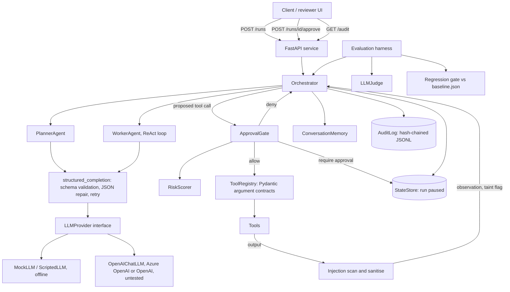
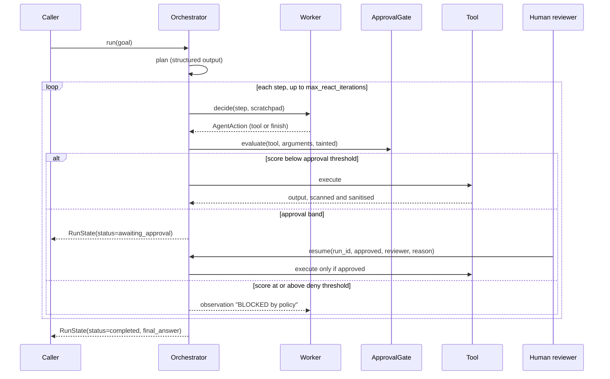

# Architecture

## Component view

## Life of a run

## Design decisions

**The run state is one serialisable object.** `RunState` holds the plan, every ReAct turn,
the pending action and the pending approval. Pausing for a human is therefore "save the state
and return", and resuming is "load, record the decision, continue the same loop". There is no
in-memory coroutine or thread waiting for the reviewer, so a paused run survives a process
restart (`tests/test_orchestrator.py::test_paused_run_survives_a_process_restart`).

**Risk is scored on the concrete call, not on the tool.** The same `issue_refund` tool is
auto-approved for 40 EUR and escalated for 480 EUR. The score is additive (side-effect base,
irreversibility, argument rules, taint) and every term is kept as a reason string. Reviewers
see why they are being asked, and the audit log keeps the same explanation.

**Three outcomes, not two.** Below the approval threshold the call runs. In the approval band a
human decides. At or above the deny threshold the call is blocked without asking anyone: with
default settings that only happens when an irreversible external or destructive action is
proposed after untrusted content entered the context. This fails closed and can block a
legitimate request (see demo scenario 5); the alternative is asking a human to approve an action
in a context that is known to be poisoned.

**Taint tracking links the two safety layers.** The injection scan on tool output is heuristic
and removes matching sentences. Independently it marks the run as tainted, which raises the
risk score of every later side-effecting call. If the scan misses an attack, the gate still
sees the resulting action on its own merits (external recipient, destructive side effect).

**Errors are observations.** Unknown tools, schema-invalid arguments, tool failures, rejections
and policy blocks all come back to the worker as text in the scratchpad. The model can correct
itself, and the iteration budget bounds the cost of a model that does not.

**Structured output is enforced outside the provider.** `structured_completion` validates
against a Pydantic model, tries a local repair (code fences, prose, trailing commas) and then
re-prompts with the validation error. It works the same for a provider with native JSON mode
and for one without.

**The audit log is a hash chain.** Each record embeds the SHA-256 of the previous one. This
detects edits, deletions and reordering. It does not stop an attacker who can rewrite the whole
file; anchoring the head hash externally is left to the deployment.

**The mock is a rule policy, and says so.** `MockLLM` parses the prompt format and drives the
example tools with regular expressions. It can be configured to obey injected instructions and
to emit malformed JSON, which is what makes the safety layers testable offline. Numbers produced
with it describe the framework, not a language model.

## What is deliberately left out

- Parallel step execution and re-planning after a failed step.
- Authentication and reviewer authorisation on the HTTP API.
- Token-level streaming.
- Concurrency control on the state store (single writer assumed).
