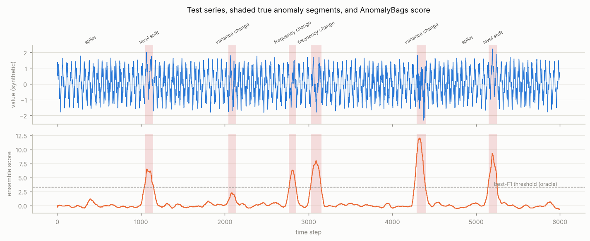
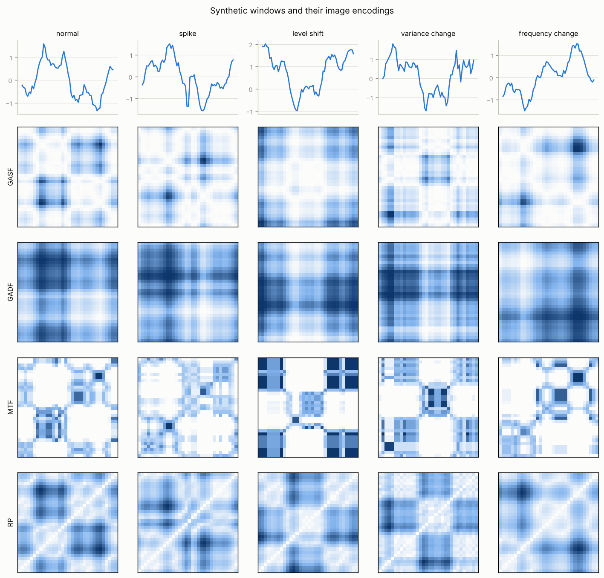
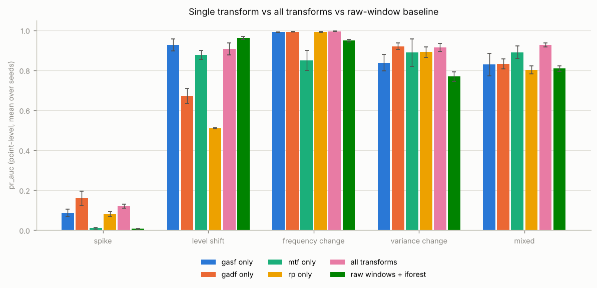

# anomalybags-ts2img

Bagging ensembles of classical anomaly detectors on image encodings of time-series
windows, implemented in numpy and scikit-learn, with a seeded synthetic benchmark
and an ablation runner.

## What it is

A reference implementation by a co-author of the AnomalyBAGS paper (see Background).
It re-implements the idea of the paper from scratch:

1. cut a time series into sliding windows,
2. encode every window as an image (Gramian Angular Summation and Difference
   Fields, Markov Transition Field, Recurrence Plot),
3. describe the images with features,
4. train many base anomaly detectors, each on a bootstrap sample of the normal
   windows, a random feature subspace, one transform and one detector family,
5. normalise and aggregate the member scores.

It is an independent re-implementation for study and reuse. It is **not** the
original research code, it does not use the datasets of the paper and it does **not**
claim to reproduce the numbers of the paper. All results below come from a synthetic
benchmark generated by this repository.

## Background

F. S. Bayram, M. Dwedar, A. Melke, R. Schneider, R. Radtke, A. Jesser (2023),
"AnomalyBAGS: Bagging-Based Ensemble Learning with Time-Series-to-Image
Transformations for Robust Anomaly Detection", IEEE ICETAS 2023,
DOI [10.1109/ICETAS59148.2023.10346596](https://doi.org/10.1109/ICETAS59148.2023.10346596).

Differences to keep in mind when reading the results:

- image features are hand-crafted (texture statistics, HOG-like histograms, PCA
  projection) because the repository must run on CPU without deep learning
  frameworks,
- the data is synthetic,
- hyperparameters are defaults, not the settings of the paper.

## Features

- Transforms in numpy, batched over windows: GASF, GADF, MTF, recurrence plot, PAA
  (`transforms.py`). Scaling constants are fitted on normal data by default; the
  textbook per-window scaling is available as an option.
- Image features without deep learning: intensity and gradient statistics, grey-level
  co-occurrence descriptors, a HOG-like descriptor, PCA projection (`features.py`).
- Base detectors: Isolation Forest, One-Class SVM, LOF from scikit-learn and a numpy
  PCA reconstruction detector (`detectors.py`).
- `AnomalyBags` ensemble over transforms x detectors x bootstrap samples x feature
  subspaces, out-of-bag score normalisation (z-score, robust, min-max, rank) and
  aggregation (mean, median, max, trimmed mean) (`ensemble.py`).
- Metrics in numpy: ROC-AUC, PR-AUC, best F1. Point-adjust is optional and reported
  under separate `pa_` keys (`metrics.py`).
- Synthetic benchmark with spike, level shift, frequency change and variance change
  anomalies (`synthetic.py`).
- Ablation runner with fixed seeds, Markdown and JSON output, figures (`ablation.py`,
  `plots.py`).

## Quickstart

```bash
pip install -e ".[dev]"
make test        # python -m pytest
make demo        # python examples/demo.py
make ablation    # python -m anomalybags.cli ablation --out docs  (about 20 minutes on 2 CPU cores)
```

```python
from anomalybags import AnomalyBags, EnsembleConfig, evaluate, make_benchmark

bench = make_benchmark(seed=0)                     # synthetic train / test / labels
model = AnomalyBags(EnsembleConfig(n_estimators=16, seed=0)).fit(bench.train)
scores = model.score_points(bench.test)            # one score per time step
print(evaluate(bench.labels, scores))
```

## Demo output

Pasted from `python examples/demo.py` in the build container (Python 3.13, 2 CPU
cores). Timings vary by machine.

```text
AnomalyBags demo on SYNTHETIC data
train points: 4000, test points: 6000, anomalous fraction: 0.102
  event spike             [ 393,  395)  magnitude -1.29
  event level_shift       [1049, 1142)  magnitude +0.57
  event variance_change   [2045, 2135)  magnitude +2.25
  event frequency_change  [2763, 2853)  magnitude +0.69
  event frequency_change  [3025, 3152)  magnitude +0.68
  event variance_change   [4293, 4402)  magnitude +3.04
  event spike             [4893, 4895)  magnitude -0.98
  event level_shift       [5151, 5247)  magnitude +0.65
members: 16 (window 64, stride 4, image 24x24)
  member gasf  + lof      features=62 in-bag=537 out-of-bag=448
  member mtf   + pca      features=62 in-bag=539 out-of-bag=446
  member gasf  + pca      features=62 in-bag=554 out-of-bag=431
  member mtf   + lof      features=62 in-bag=532 out-of-bag=453
fit time: 4.28 s, scoring time: 2.17 s
point-level metrics (unadjusted):
  ensemble           ROC-AUC 0.989  PR-AUC 0.916  best-F1 0.861
  raw-window iforest ROC-AUC 0.928  PR-AUC 0.788  best-F1 0.722
point-adjusted best-F1 (optimistic protocol, for reference only): 0.906
```





## Results on the synthetic benchmark

All tables are in [docs/results.md](docs/results.md), raw numbers in
[docs/ablation_results.json](docs/ablation_results.json). They were produced by
`python -m anomalybags.cli ablation` with dataset seeds 0, 1, 2, anomaly difficulty
0.6, window 64, stride 4, 24 x 24 images and 16 members. Metrics are point-level
and unadjusted. Values are mean +/- standard deviation over the three dataset seeds.

### Single transform vs all transforms (PR-AUC)

| configuration | spike | level_shift | frequency_change | variance_change | mixed |
|---|---|---|---|---|---|
| gasf only | 0.086 +/- 0.019 | 0.927 +/- 0.030 | 0.990 +/- 0.002 | 0.837 +/- 0.041 | 0.828 +/- 0.056 |
| gadf only | **0.159 +/- 0.036** | 0.671 +/- 0.038 | 0.992 +/- 0.001 | **0.920 +/- 0.015** | 0.832 +/- 0.026 |
| mtf only | 0.009 +/- 0.004 | 0.877 +/- 0.023 | 0.849 +/- 0.050 | 0.888 +/- 0.069 | 0.890 +/- 0.031 |
| rp only | 0.080 +/- 0.012 | 0.509 +/- 0.003 | 0.991 +/- 0.002 | 0.891 +/- 0.026 | 0.802 +/- 0.020 |
| all transforms | 0.121 +/- 0.010 | 0.907 +/- 0.031 | **0.994 +/- 0.001** | 0.913 +/- 0.020 | **0.927 +/- 0.011** |
| raw windows + iforest | 0.007 +/- 0.002 | **0.960 +/- 0.007** | 0.948 +/- 0.006 | 0.769 +/- 0.023 | 0.808 +/- 0.014 |



### Ensemble size (mixed scenario)

| members | roc_auc | pr_auc | best_f1 | pa_best_f1 (optimistic) |
|---|---|---|---|---|
| 1 | 0.978 +/- 0.010 | 0.840 +/- 0.068 | 0.804 +/- 0.052 | 0.906 +/- 0.045 |
| 2 | 0.986 +/- 0.005 | 0.866 +/- 0.057 | 0.839 +/- 0.036 | 0.910 +/- 0.050 |
| 4 | 0.986 +/- 0.003 | 0.869 +/- 0.038 | 0.831 +/- 0.033 | 0.892 +/- 0.036 |
| 8 | 0.989 +/- 0.001 | 0.897 +/- 0.020 | 0.838 +/- 0.018 | 0.909 +/- 0.016 |
| 16 | 0.991 +/- 0.001 | 0.928 +/- 0.012 | 0.859 +/- 0.011 | 0.931 +/- 0.046 |
| 32 | 0.991 +/- 0.001 | 0.928 +/- 0.014 | 0.862 +/- 0.012 | 0.933 +/- 0.044 |

### What the runs show

Where the ensemble helps:

- **Mixed anomaly types.** With all four anomaly types in one series the full
  ensemble reaches PR-AUC 0.927, above every single-transform ensemble (0.802 to
  0.890) and above the raw-window Isolation Forest baseline (0.808). In this
  scenario no individual member beat the aggregated score in any of the three seeds
  (`frac_members_better` = 0.000 in docs/results.md, section 3).
- **Stability.** Going from 1 to 16 members raises the mean PR-AUC from 0.840 to
  0.928 and cuts its standard deviation from 0.068 to 0.012. There is no gain from
  16 to 32 members.

Where the ensemble does not help:

- **Single anomaly types.** The full ensemble is the best configuration only for
  frequency changes, by a margin inside the noise. For spikes GADF alone is better
  (0.159 vs 0.121), for variance changes GADF alone is marginally better (0.920 vs
  0.913), and for level shifts the plain raw-window Isolation Forest wins (0.960 vs
  0.907) without any image transform. Averaging over transforms that are blind to
  an anomaly type (RP reaches 0.509 on level shifts, MTF 0.009 on spikes) dilutes
  the transforms that see it.
- **Oracle member selection.** For every single-type scenario the best individual
  member, chosen with test labels, beats the ensemble (for example 0.978 vs 0.907 on
  level shifts), and 8 to 31 percent of the members score higher than the aggregate.
  The ensemble trades peak performance for not having to know the anomaly type.
- **Detector diversity.** Mixing the four detector families is not better than the
  best single family: One-Class SVM alone reaches 0.944 on the mixed scenario, the
  mixed-detector ensemble 0.927 (docs/results.md, section 2).
- **Spikes are hard at point level.** No configuration exceeds PR-AUC 0.22 on
  spikes, although ROC-AUC reaches 0.92. A one-to-three point spike raises the score
  of every window that contains it, so the detector flags a neighbourhood of about
  one window length. The shortest window (32) is the best for spikes (0.204).
- **Long windows hurt.** Window 128 lowers the mixed PR-AUC from 0.927 to 0.640.

Other observations:

- Fitting the scaling on normal data matters: with textbook per-window scaling the
  mixed PR-AUC falls from 0.927 to 0.805.
- Rank normalisation scored higher than the default z-score in this benchmark
  (PR-AUC 0.953 to 0.967 vs 0.927, docs/results.md, section 6). The default was not
  changed after seeing this result, because that would be tuning on the test data.
- `pa_best_f1` is 0.05 to 0.10 above the unadjusted best F1 throughout. A unit test
  (`tests/test_metrics.py`) shows that point-adjust gives a best F1 above 0.5 for
  random scores, which is why it is never used as the headline metric here.

## Architecture

See [docs/architecture.md](docs/architecture.md) for the mermaid diagram, the
module table and the design decisions (scaling fitted on normal data, out-of-bag
score normalisation, member plan, unadjusted point-level evaluation).

```text
src/anomalybags/
  windowing.py   transforms.py   features.py   detectors.py
  ensemble.py    metrics.py      synthetic.py  ablation.py
  plots.py       cli.py
```

## Tests

```bash
python -m pytest
```

59 tests. They check the transforms against their definitions (for example GASF
against `cos(phi_i + phi_j)`), the metrics against scikit-learn and brute force, the
window-to-point projection against a brute-force loop, detector ranking on planted
outliers, determinism under fixed seeds and the command line demo. CI
(`.github/workflows/ci.yml`) runs ruff and pytest on Python 3.10 and 3.12. The
workflow file has not been executed on GitHub; lint and tests were run locally on
Python 3.13.

## Limitations

- The benchmark is synthetic and univariate, with one signal family (two sinusoids
  plus AR(1) noise). Results on real data can differ in ranking and magnitude.
- No comparison with the numbers of the paper is possible or intended: different
  data, different feature extractor, default hyperparameters.
- The training series is assumed to be anomaly-free. Contaminated training data was
  not studied.
- Three dataset seeds give a rough idea of variance, not a significance test.
  Differences of the size of one standard deviation should be read as ties.
- Best F1 uses an oracle threshold. No threshold selection method is included.
- Detection is offline and window-based. Localisation is limited to roughly one
  window length, which is what limits the point-level precision on spikes.
- Only univariate series are supported.

## License

MIT, Copyright (c) 2026 M. Emad Dwedar. See [LICENSE](LICENSE).
