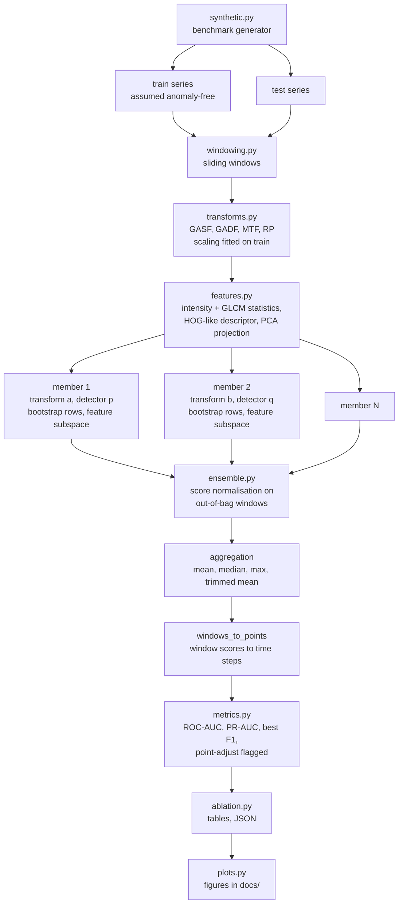

# Architecture

## Data flow

## Modules

| module | responsibility |
|---|---|
| `windowing.py` | Sliding windows, window labels, projection of window scores to points |
| `transforms.py` | Gramian Angular Summation and Difference Fields, Markov Transition Field, Recurrence Plot, PAA; `ImageTransformer` with scaling fitted on normal data |
| `features.py` | Framework-free image features: intensity and gradient statistics, GLCM texture descriptors, HOG-like histograms, PCA projection |
| `detectors.py` | Isolation Forest, One-Class SVM, LOF (scikit-learn) and a numpy PCA reconstruction detector behind one `fit` / `score` interface |
| `ensemble.py` | `AnomalyBags`: member plan over transforms x detectors, bootstrap rows, random feature subspaces, out-of-bag score normalisation, aggregation |
| `metrics.py` | ROC-AUC, PR-AUC, best F1 in numpy; point-adjust protocol under `pa_` keys |
| `synthetic.py` | Seeded synthetic benchmark with spike, level shift, frequency change and variance change anomalies |
| `ablation.py` | Fixed-seed studies and Markdown rendering |
| `plots.py`, `cli.py` | Figures and command line |

## Design decisions

1. **Scaling fitted on normal data.** The textbook Gramian field rescales each
   window to [-1, 1]. That is appropriate for classification of whole series, but for
   anomaly detection it deletes exactly the information that a level shift or a
   variance change carries once the anomaly fills the window. `ImageTransformer`
   therefore fits the value range, the MTF bin edges and the recurrence distance
   scale on the training series. The per-window variant is kept as `scale="window"`
   and is part of the scoring ablation.

2. **Hand-crafted image features instead of a CNN.** The repository must run offline
   on CPU without deep learning frameworks. The paper family of methods usually
   feeds the images to a neural feature extractor; here the images are summarised by
   texture statistics, a HOG-like descriptor and a PCA projection. This is a
   deliberate substitution and one reason why the numbers are not comparable with the
   paper.

3. **Diversity from four sources.** Members differ in transform, detector family,
   bootstrap sample and feature subspace. The member plan walks through a shuffled
   transform x detector grid, so an ensemble of 16 members covers each of the 16
   pairs exactly once and larger ensembles repeat the grid with new bootstrap
   samples.

4. **Out-of-bag normalisation.** Detector scores have incomparable scales. Each
   member is normalised with the scores of its own out-of-bag training windows.
   Using in-bag windows would understate the normal score level of detectors such
   as LOF, which score their own training points optimistically.

5. **Point-level evaluation without adjustment by default.** Window scores are
   projected to time steps by averaging over all covering windows. Metrics are
   computed per time step. The point-adjust protocol is implemented because many
   papers report it, but its results carry a `pa_` prefix and a unit test shows that
   it gives a best F1 above 0.5 for random scores.

6. **Oracle quantities are labelled.** Best F1 uses the threshold that maximises F1
   on the test labels, and the best ensemble member in the member study is selected
   with test labels. Both are upper bounds and are named as such in the tables.

7. **Fixed seeds everywhere.** Dataset seeds, ensemble seeds and detector seeds are
   explicit, so `python -m anomalybags.cli ablation` regenerates the tables.
