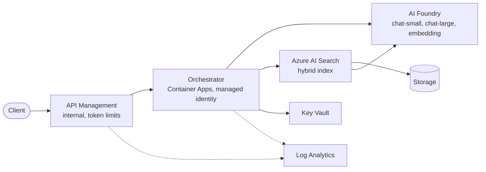

# azure-agentic-rag-reference-architecture

Reference architecture for a secure enterprise agentic RAG platform on Azure: Bicep templates,
Architecture Decision Records, diagrams, and `archkit`, a tested Python package that estimates
capacity and cost, scores an architecture description against Well-Architected style rules and
statically validates the Bicep against policy rules.

## What it is

| Part | Location | Content |
| --- | --- | --- |
| Infrastructure as code | `infra/` | `main.bicep`, 11 modules, an API Management policy, `dev` and `prod` parameter files |
| Decisions | `docs/adr/` | 8 ADRs: buy vs build, private networking, identity and zero trust, model routing, data residency, cost governance, compute platform, evaluation and Responsible AI |
| Diagrams | `docs/architecture.md` | Mermaid context, container, network and sequence views |
| Tooling | `src/archkit/` | Capacity and cost estimator, checklist engine, Bicep parser and policy validator, CLI |

Honest status of the infrastructure code:

- The templates and both parameter files compile with the Bicep CLI (version 0.49.2, run on
  2026-11-17 in the build container) with 0 errors and 0 warnings, and `bicep lint` reports nothing.
- They pass all 11 rules of the `archkit` static validator.
- They have **not been deployed** to an Azure subscription and no `what-if` was run, because no
  subscription was available. Compilation checks syntax and resource type schemas. It does not
  prove that a deployment succeeds: quota, regional model availability, SKU constraints, policy
  assignments and ordering issues only show up at deployment time.

## Background

Reference implementation by M. Emad Dwedar, Microsoft AI Consultant and Azure Solutions Architect
Expert, AI researcher at TUM Heilbronn and co-founder of AsetraAI. The repository condenses
architecture patterns the author applies when designing retrieval-augmented and agentic systems
on Azure into one reviewable example. It is not the production code or the infrastructure of any
company or customer, and the workloads, prices and architecture descriptions in `examples/` are
made up for demonstration.

## Features

Infrastructure (`infra/`):

- Azure AI Foundry account with Azure OpenAI model deployments, pinned versions, key auth disabled
- Azure AI Search with Entra-only auth, replicas and partitions as parameters
- Container Apps environment (internal, zone redundant) and an orchestrator app with a
  user-assigned managed identity
- API Management in internal VNet mode as AI gateway: Entra token validation, tokens-per-minute
  limit per subscription, token metrics, backend circuit breaker
- Key Vault (RBAC, purge protection), Storage, Log Analytics and Application Insights
- VNet with three subnets and NSGs, private DNS zones, private endpoints for every data service
- Least-privilege data plane role assignments, diagnostic settings on every service, tags everywhere

`archkit` (Python, offline, no Azure calls):

- `archkit estimate`: token throughput per model class from a workload description (requests per
  day, hourly profile, burst factor, LLM calls per request, routing shares, cache share), pay as
  you go versus PTU versus hybrid PTU with spillover, PTU break-even utilization and volume, AI
  Search index size and the cheapest feasible tier, partitions and replicas
- `archkit assess`: 44 rules in 6 pillars (security, reliability, cost, operations, performance,
  Responsible AI) written in a small declarative condition language with three-valued logic,
  severity-weighted pillar scores, a gate, markdown and JSON reports
- `archkit validate-bicep`: a recursive-descent parser for the declarative subset of Bicep and 11
  policy rules (no public network access, private endpoints, managed identity, no key auth, no
  privileged roles, secure parameters, no secret outputs, TLS and deletion protection, diagnostic
  settings, tags, required tag keys) with justified suppressions

Prices: `src/archkit/data/illustrative_prices.yaml` holds **illustrative placeholder** unit prices
and capacity figures. They are not current Azure prices, quotas or PTU throughput numbers. Supply
your own file with `--prices` before using any result.

## Quickstart

```bash
cd azure-agentic-rag-reference-architecture
python -m venv .venv && source .venv/bin/activate
make install        # pip install -e ".[dev]"
make test           # python -m pytest
make lint           # ruff check and ruff format --check
make demo           # python examples/demo.py

archkit estimate examples/workload.yaml
archkit assess examples/architecture.yaml          # exit code 1 if the gate fails
archkit validate-bicep infra --strict              # exit code 1 on findings
make bicep-build                                   # needs the Bicep CLI on PATH
```

Deploying is at your own risk and after your own review. Start with a what-if:

```bash
az group create -n rg-ragref-dev -l swedencentral
az deployment group what-if -g rg-ragref-dev -f infra/main.bicep -p infra/parameters/dev.bicepparam
```

## Demo output

Output of `python examples/demo.py` on 2026-11-17 (Python 3.13). All money figures derive from the
placeholder price book and an invented workload, so they illustrate the calculation only.

```text
==============================================================================
1. Capacity and cost estimate (ILLUSTRATIVE placeholder prices, not Azure prices)
==============================================================================
workload: internal-knowledge-assistant
requests per month: 12,000,000
peak requests per minute: 1,050.0

[chat-small] peak TPM in/out: 6,693,750 / 669,375
  * hybrid ptus=15    total=   17,456.31 spillover= 73.8% ptu_utilization= 72.1%
    payg   ptus=0     total=   18,360.00 spillover=100.0% ptu_utilization=  0.0%
    ptu    ptus=160   total=   41,600.00 spillover=  0.0% ptu_utilization= 25.8%
    PTU break-even utilization: 57.7%

[chat-large] peak TPM in/out: 2,520,000 / 315,000
  * hybrid ptus=60    total=  109,495.20 spillover= 80.5% ptu_utilization= 81.2%
    payg   ptus=0     total=  116,640.00 spillover=100.0% ptu_utilization=  0.0%
    ptu    ptus=945   total=  245,700.00 spillover=  0.0% ptu_utilization= 26.5%
    PTU break-even utilization: 55.0%

AI Search: 36,000,000 chunks, vector index 63.21 GB, storage 483.98 GB
  cheapest feasible: tier=standard partitions=4 replicas=3 monthly=3,000.00

monthly total: 132,096.51 USD
cost per request: 0.0110 USD

==============================================================================
2. Well-Architected style assessment
==============================================================================

agentic-rag-reference (prod): gate=PASS overall=92.5
  pillars: security=100, reliability=87, cost=100, operations=93, performance=75, responsible_ai=90
  gaps: 4 (critical: 0)
    - PERF-01 [high] A latency objective is defined and load tested (fail)
    - RAI-07 [medium] The system has been red teamed (fail)
    - REL-06 [medium] The index can be rebuilt from source and the rebuild has been tested (fail)
    - OPS-07 [low] Runbooks exist for the main failure modes (fail)

chatbot-poc: gate=FAIL overall=9.1
  pillars: security=0, reliability=0, cost=0, operations=0, performance=33, responsible_ai=24
  gaps: 36 (critical: 3)
    - SEC-01 [critical] PaaS data services expose no public endpoint (fail)
    - SEC-02 [critical] Service-to-service calls use managed identity and local auth is disabled (fail)
    - SEC-04 [critical] Retrieval enforces document-level access control (unknown)
    - COST-01 [high] Token consumption is limited per consumer (fail)

==============================================================================
3. Static Bicep policy validation of infra/
==============================================================================
files=12 resources=46 rules=11
errors=0 warnings=0 suppressed=0
result: PASS
```

How to read it: with the placeholder prices, a PTU pays off above roughly 55 to 58 percent average
utilization. The office-hours profile keeps a peak-sized PTU deployment at about 26 percent, so
full PTU is the most expensive option and a small PTU base with spillover is the cheapest. The
first assessment is a self-declared target state (see the comment in `examples/architecture.yaml`),
the second is a deliberately weak example.

While building this repository the validator found two real defects in the first version of the
templates: the Application Insights connection string was passed to two modules as a plain
parameter (rule SEC-001). Both parameters are now `@secure()` and the Container App reads the
value from a secret.

## Architecture

See [docs/architecture.md](docs/architecture.md) for the four diagrams and
[docs/adr/](docs/adr/README.md) for the decisions. Container view in short:



Package layout:

```text
src/archkit/
  capacity.py        workload model and token demand per model class
  cost.py            pay-as-you-go, PTU and hybrid cost, break-even
  search_sizing.py   index size, partitions, replicas, tier selection
  estimate.py        end-to-end estimate and report
  pricing.py         typed price book loader
  checklist.py       condition language, scoring, gate, report
  bicep/parser.py    tolerant Bicep parser
  bicep/policy.py    policy rules and report
  cli.py             archkit estimate | assess | validate-bicep
  data/              illustrative_prices.yaml, waf_rules.yaml
```

## Tests

`python -m pytest` runs 74 test cases (59 test functions, some parametrised) in about one
second: parser behaviour (comments, strings, nested resources, loops, conditions, error line
numbers), each policy rule with passing and failing templates, estimator arithmetic checked
against hand calculations, checklist logic and scoring, CLI exit codes, and the repository's own
`infra/` directory and examples. CI (`.github/workflows/ci.yml`) runs ruff, pytest, the static
validator and, in a second job, compiles the templates with the Bicep CLI.

## Limitations

- Not deployed. See the status section above. Expect to adjust API versions, SKUs, model names,
  quotas and subnet sizes for your tenant and region.
- The prices and capacity figures are placeholders. The search size model (bytes per vector, HNSW
  overhead, text factor) is an approximation and should be replaced by measurements from a pilot
  index.
- The hybrid PTU model works on hourly averages and therefore underestimates spillover caused by
  bursts within an hour. It does not model latency.
- The Bicep parser covers declarations, objects, arrays, loops and conditions. Expressions are kept
  as text and not evaluated, so a property set through a parameter or ternary yields a warning,
  not a verdict. User-defined types and functions, lambdas and multi-line ternaries are skipped or
  unsupported. It is not a replacement for Azure Policy or PSRule.
- The checklist scores a self-declared YAML description. It does not inspect Azure resources, and
  its rules are this repository's own selection, not an official Microsoft Well-Architected Review.
- The orchestrator application itself is out of scope. The parameter files reference a public
  quickstart image as a placeholder.
- The Log Analytics workspace keeps public endpoints (documented exception in ADR 0002). No
  firewall, Application Gateway, hub network, second region or customer-managed keys are included.
- The ADRs are architecture guidance. ADR 0005 is not legal advice.

## License

MIT, see [LICENSE](LICENSE). Copyright (c) 2026 M. Emad Dwedar.
