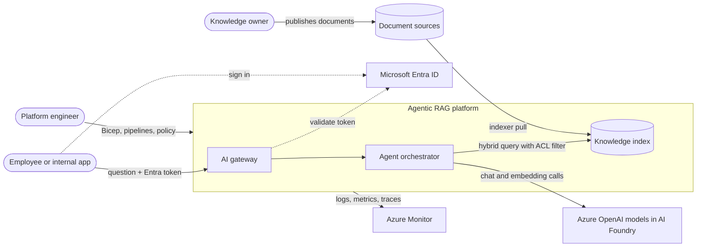
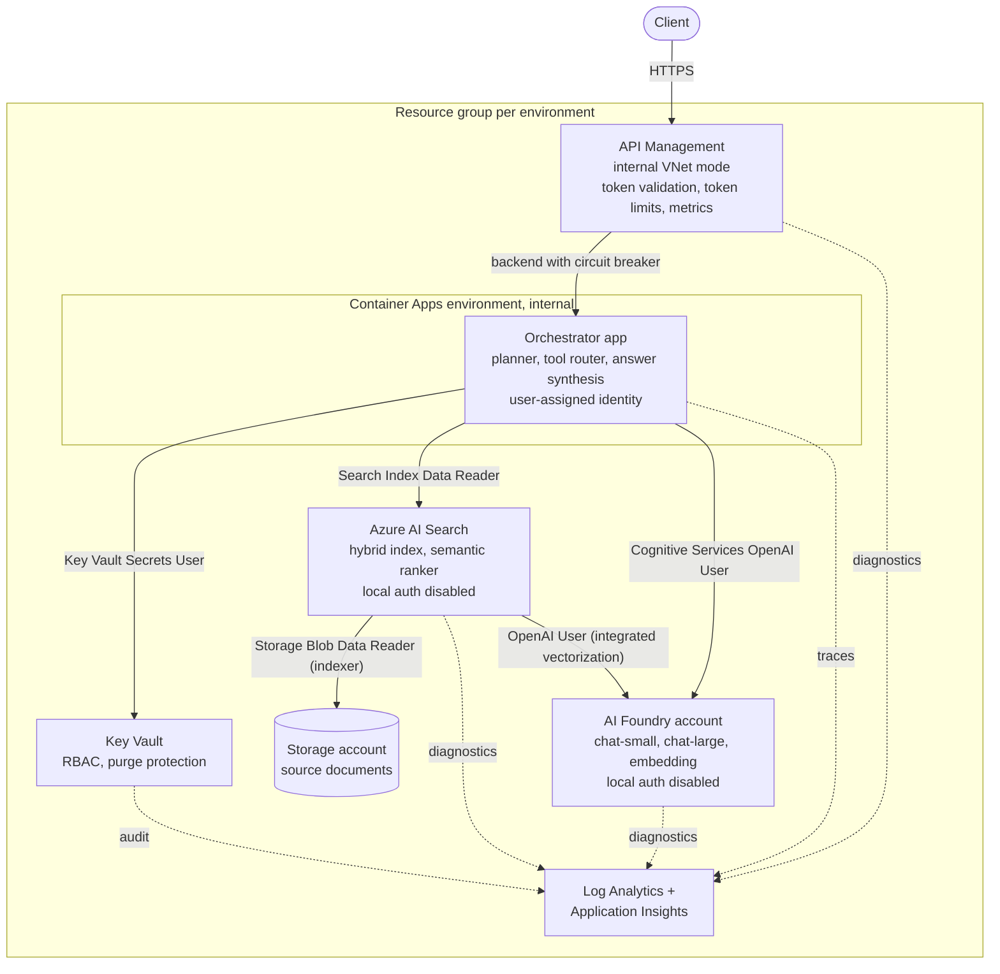
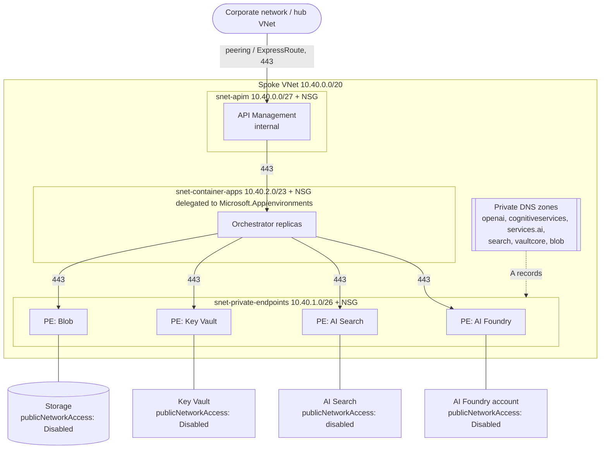
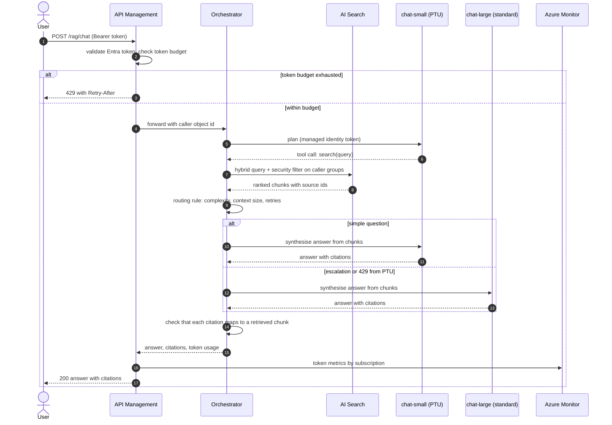
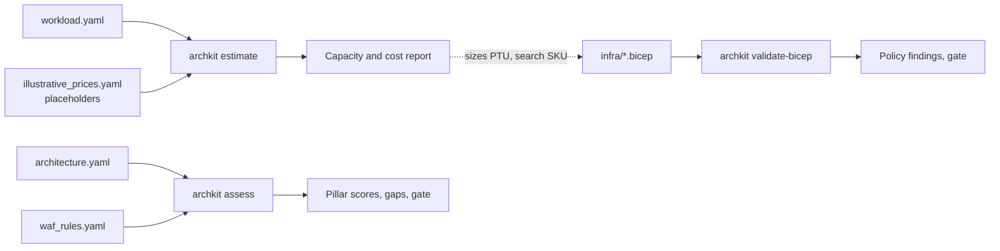

# Architecture

This document describes the reference design that the Bicep in `infra/` implements and that the
ADRs in `docs/adr/` justify. Four views are given: context, container, network and a request sequence.

Status of this design: the templates compile with the Bicep CLI and pass the `archkit` static
policy validator. They have not been deployed to an Azure subscription by the author of this
repository. Treat the design as a reviewed starting point, not as a certified landing zone.

## 1. Context

Who uses the platform and which external systems it depends on.

## 2. Container view

Deployable units and the Azure services behind them. Every arrow between services is authenticated
with a managed identity and a data plane role (ADR 0003).

| Container | Bicep module | Responsibility |
| --- | --- | --- |
| API Management | `modules/apim.bicep`, `policies/chat-api-policy.xml` | Single entry point, Entra token validation, tokens-per-minute limit per subscription, token metrics for showback |
| Orchestrator | `modules/container-apps.bicep` | Agent loop: plan, retrieve, call tools, synthesise a cited answer, route between small and large model |
| AI Foundry account | `modules/openai.bicep` | Model deployments with pinned versions and content filter policy |
| AI Search | `modules/search.bicep` | Hybrid (keyword + vector) index with security trimming fields |
| Storage | `modules/storage.bicep` | Source documents for the indexer |
| Key Vault | `modules/keyvault.bicep` | Third-party secrets and optional customer-managed keys |
| Network | `modules/network.bicep`, `modules/private-endpoint.bicep` | VNet, subnets, NSGs, private DNS zones, private endpoints |
| Identity | `modules/identity.bicep`, `modules/role-assignments.bicep` | Workload identity and least-privilege role assignments |
| Monitoring | `modules/monitoring.bicep` | Log Analytics workspace and Application Insights |

## 3. Network view

No PaaS data service has a public endpoint. The gateway is reachable only from inside the virtual
network (or from peered networks and an upstream Application Gateway, which are out of scope here).

Known exception: the Log Analytics workspace keeps public ingestion and query endpoints. Closing
them needs an Azure Monitor Private Link Scope, which is usually owned by the platform landing zone
and is therefore not created by this workload template (see ADR 0002).

## 4. Request sequence

One chat request, including the model routing decision (ADR 0004) and the spillover path from
provisioned to standard capacity.

## Design decisions

| ADR | Decision |
| --- | --- |
| [0001](adr/0001-buy-vs-build.md) | Use managed Azure AI services for models and retrieval, build only the orchestrator |
| [0002](adr/0002-private-networking.md) | Private endpoints and disabled public access for all data services |
| [0003](adr/0003-identity-and-zero-trust.md) | Managed identity and Entra ID everywhere, no keys |
| [0004](adr/0004-model-routing.md) | Small model by default, rule-based escalation to the large model |
| [0005](adr/0005-data-residency.md) | Regional or data zone deployments only, single-geography data flow |
| [0006](adr/0006-cost-governance.md) | Gateway token limits, showback tags and PTU sizing from measured demand |
| [0007](adr/0007-compute-platform.md) | Container Apps instead of AKS for the orchestrator |
| [0008](adr/0008-evaluation-and-responsible-ai.md) | Evaluation gate and Responsible AI controls as release criteria |

## How archkit relates to the design

