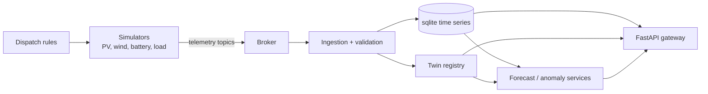

# energy-iot-forecasting-platform

An event-driven energy IoT mini-platform that runs fully in one Python process: simulated PV, wind
and battery devices publish telemetry on MQTT-style topics, an ingestion service validates and
stores it, a digital-twin registry tracks asset state, and ML services do maximum power point (MPP)
voltage prediction, short-term forecasting and anomaly detection. A rule-based dispatcher and a
FastAPI gateway sit on top.

**All data in this repository is simulated.** There are no field measurements, and the numbers
below describe the behaviour of the code on synthetic data only.

## Background

Reference implementation by the author of:

> Mahdy, A., Dwedar, M., Jesser, A. (2026). "Machine Learning-Driven Voltage Control and
> Prediction for Maximum Power Point Optimization in Solar Energy Harvesting Systems".
> IEEE ICMI 2026.

The MPPT part of this repository implements the idea of that paper (predict the MPP voltage with a
regressor instead of searching for it) against a simulated single-diode module, next to the classic
Perturb and Observe and Incremental Conductance trackers. It is not the original research code, it
does not use the paper's data or hardware, and it does not reproduce or claim the paper's results.
The platform part (broker, ingestion, twins, gateway, Azure mapping) reflects IoT architecture
patterns from the author's work as a solution architect. It is not production code of any company.

## Features

- **Device simulators**: single-diode PV module (Newton solution of the implicit I-V equation,
  irradiance and temperature dependence, true MPP by numerical optimisation), wind turbine power
  curve, battery with power limits and efficiencies, synthetic weather and load.
- **Broker abstraction**: in-process broker with MQTT `+` and `#` wildcards, handler isolation and
  dead letters. Optional `paho-mqtt` adapter (not covered by tests).
- **Ingestion**: pydantic schema validation, topic and identity checks, rejection counters.
- **Time-series store**: sqlite, idempotent writes, range queries.
- **Digital-twin registry**: assets, parent-child relationships, reported state, staleness.
- **ML services**
  - MPP voltage prediction (linear model on log features, random forest, gradient boosting)
    compared with Perturb and Observe and Incremental Conductance on tracking efficiency under
    changing irradiance, plus a hybrid that seeds Perturb and Observe with the prediction.
  - PV and load forecasting with lag features against persistence and seasonal persistence
    (MAE, RMSE, skill score), chronological split.
  - Anomaly detection: physics-informed residual detector and an Isolation Forest baseline,
    evaluated on labelled injected faults.
- **Dispatch**: rule-based self-consumption and peak-shaving strategies for PV + battery + load.
- **Gateway**: FastAPI endpoints for assets, telemetry, forecasts, anomalies and dispatch.
- **Docs**: reference architecture with a mapping to Azure IoT Hub, Event Grid, Stream Analytics,
  Digital Twins and AKS, and OPC UA / Modbus integration points, as design guidance.

## Quickstart

```bash
python -m venv .venv && source .venv/bin/activate
make install        # pip install -e ".[dev]"
make test
make demo           # python examples/run_demo.py
make serve          # optional, needs: pip install uvicorn
```

Gateway endpoints: `GET /health`, `GET /assets`, `GET /assets/{id}`,
`GET /assets/{id}/telemetry?metric=&start=&end=&limit=`, `POST /telemetry`,
`GET /forecasts/{pv|load|wind}?horizon_steps=`, `GET /anomalies/pv`, `GET /dispatch/summary`.

## Demo output

Output of `python examples/run_demo.py` in the build container (Python 3.13, scikit-learn 1.9,
seed 7). Wall time varies by machine. Everything else is deterministic for a given library version.

```text
NOTE: all data in this demo is SIMULATED (single-diode PV model, synthetic weather).

== 1. Event-driven platform: 30 simulated days at 15 minute resolution ==
steps simulated          : 2880
messages published       : 11520
messages accepted        : 11520, rejected: 0
points in sqlite store   : 28800
wall time                : 0.5 s
malformed message        : rejected=1 reasons={'schema': 1}
PV twin                  : rated 2954.6 W, status online, messages 2880

== 2. MPP voltage prediction vs classic MPPT (3000 control periods) ==
module at STC            : Vmpp 30.31 V, Pmpp 246.2 W
regressor linear_log_features : hold-out MAE 0.084 V, R2 0.9985
regressor random_forest       : hold-out MAE 0.079 V, R2 0.9981
regressor gradient_boosting   : hold-out MAE 0.079 V, R2 0.9986
tracking efficiency perturb_and_observe                       : 99.38 %
tracking efficiency incremental_conductance                   : 99.50 %
tracking efficiency ml_voltage_prediction[gradient_boosting]  : 99.99 %
tracking efficiency ml_seeded_perturb_and_observe             : 99.80 %
model mismatch: same controllers on an aged module (Rs x2, Iph -8 %), no retraining
tracking efficiency perturb_and_observe                       : 99.43 %
tracking efficiency incremental_conductance                   : 99.38 %
tracking efficiency ml_voltage_prediction[gradient_boosting]  : 99.10 %
tracking efficiency ml_seeded_perturb_and_observe             : 99.29 %

== 3. Forecasting 1 hour ahead (4 steps), chronological 75/25 split ==
pv   n_train 2068 n_test 716
     model       : MAE   152.8 W  RMSE   279.7 W
     persistence : MAE   253.7 W  RMSE   399.2 W
     seasonal    : MAE   216.0 W  RMSE   394.3 W
     skill vs persistence +0.299, vs seasonal +0.291
load n_train 2068 n_test 716
     model       : MAE    72.0 W  RMSE   103.9 W
     persistence : MAE   157.3 W  RMSE   214.1 W
     seasonal    : MAE   102.3 W  RMSE   139.9 W
     skill vs persistence +0.515, vs seasonal +0.257

== 4. Anomaly detection on PV telemetry with injected faults ==
faults injected          : 23 events, 131 faulty samples of 1440
residual detector        : precision 0.845 recall 0.954 F1 0.896
isolation forest         : precision 0.504 recall 0.504 F1 0.504

== 5. Rule-based dispatch over the same 30 days (PV + wind, battery 5 kWh) ==
no battery       : import  140.9 kWh, export  435.7 kWh, peak import   1578 W, self-sufficiency  69.4 %, self-consumption  42.3 %, cycles   0.0
self_consumption : import   26.7 kWh, export  309.6 kWh, peak import   1089 W, self-sufficiency  94.2 %, self-consumption  59.0 %, cycles  24.0
peak_shaving     : import   48.3 kWh, export  333.6 kWh, peak import   1000 W, self-sufficiency  89.5 %, self-consumption  55.8 %, cycles  19.5
```

How to read this honestly:

- The ML tracker reaches 99.99 % on the nominal module because it is given irradiance and
  temperature sensors and is tested on the same module model that produced its training labels.
  On the aged module, without retraining, it falls to 99.10 % and is below both classic trackers,
  which need no model. The hybrid sits in between in both cases. The classic trackers are already
  above 99 % here, so the absolute gain available in this simulation is small.
- Forecast skill is measured on a synthetic weather process (AR(1) cloud cover). It says that the
  pipeline is leak-free and beats persistence on this process, not how it performs on real sites.
- The residual detector knows the PV model, the Isolation Forest does not. Faults are injected in
  daylight only, because a dropout at night cannot be observed.

## Architecture



Details, design decisions, the Azure service mapping and the OPC UA / Modbus integration points
are in [docs/architecture.md](docs/architecture.md).

```text
src/energy_iot/
  broker.py        in-process MQTT-style broker, optional paho adapter
  schemas.py       telemetry schema and topic convention
  simulators/      pv.py (single-diode model), devices.py (wind, battery, weather, load)
  ingestion.py     validation and persistence
  store.py         sqlite time-series store
  twin.py          digital-twin registry
  ml/              mppt.py, forecast.py, anomaly.py
  dispatch.py      rule-based dispatch
  platform.py      composition root and simulated site
  api.py           FastAPI gateway
```

## Tests

`pytest` runs 52 tests in about 10 seconds on CPU. They cover topic matching, schema rejection
cases, the single-diode equation residual, MPP against a dense voltage scan, agreement of the
batch and scalar MPP solvers, battery limits and round-trip efficiency, store idempotency, twin
state handling, ingestion rejection reasons, run reproducibility, site energy balance, MPPT
convergence, absence of future leakage in forecast features, fault injection and detection,
dispatch energy conservation, and all gateway endpoints through the FastAPI test client.
CI (`.github/workflows/ci.yml`) runs `ruff check` and `pytest`.

## Limitations

- Simulated data only. The PV parameters describe a generic 60-cell module and are not fitted to
  a datasheet. Partial shading (multiple power maxima) is not modelled, so the classic trackers
  are not tested in the situation where they are known to fail.
- The MPPT comparison is a quasi-static simulation with one voltage setpoint per control period.
  Converter dynamics, switching ripple and ADC quantisation are not modelled. The step sizes of
  the classic trackers were chosen by hand, not tuned.
- The weather generator is a simple stochastic process without real meteorology. Forecast and
  dispatch figures do not transfer to a real site.
- Dispatch is rule-based, not optimal, and does not yet use the forecasts.
- The in-process broker is synchronous. It does not model QoS levels, retained messages, latency
  or back-pressure. The `PahoMqttBroker` adapter was only checked up to client construction (the
  connection attempt fails without a broker) and has no automated tests.
- The Azure and OPC UA / Modbus mapping is design guidance. Nothing was deployed.
- The gateway has no authentication and trains forecast models on request, which is fine for a
  demo and not for a service.

## License

MIT, see [LICENSE](LICENSE). Copyright (c) 2026 M. Emad Dwedar.
