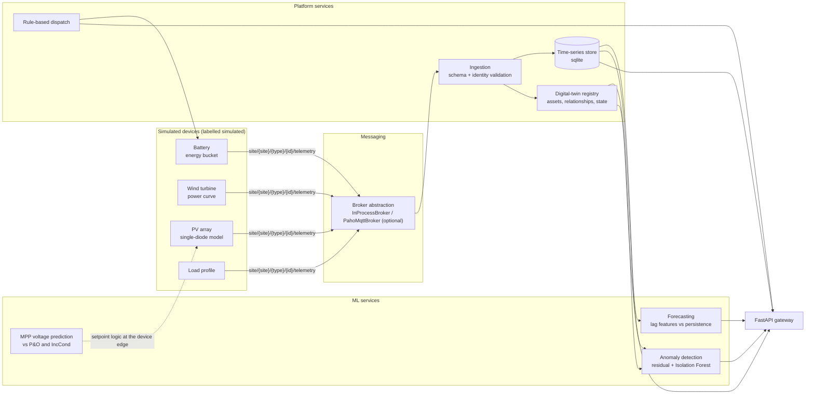

# Architecture

This document describes the reference architecture implemented in this repository and how each
component would map to managed Azure services and to industrial protocols. The Azure and
OPC UA / Modbus sections are design guidance. Nothing in this repository connects to Azure or to
a field device, and no part of the mapping has been deployed or load tested here.

## Component view



## Data flow

1. A simulator computes the physical state of an asset for one time step and publishes one JSON
   message on `site/<site>/<asset_type>/<asset_id>/telemetry`.
2. The broker delivers the message to every matching subscription. `+` and `#` wildcards follow
   MQTT semantics. A failing subscriber is isolated: the error is counted and the message is kept
   in a dead-letter list.
3. The ingestion service validates the payload (pydantic model, required metrics per asset type,
   finite values, plausibility bounds), checks that the topic agrees with the payload identity and
   that the asset exists in the twin registry with the same type. Rejections are counted by reason.
4. Accepted samples are written to the time-series store and merged into the twin state.
5. ML services and the gateway read from the store and the registry only. They never read
   simulator internals, so replacing the simulators with field devices would not change them.

## Mapping to Azure services (design guidance)

| Component in this repo | Azure service | Notes |
| --- | --- | --- |
| `InProcessBroker`, topic convention | Azure IoT Hub (device-to-cloud messages, MQTT endpoint) or Event Grid MQTT broker | IoT Hub gives per-device identity, device twins and direct methods. The Event Grid MQTT broker fits when free-form topic hierarchies such as the one used here are required. |
| Topic routing by wildcard | IoT Hub message routing, Event Grid topic spaces and subscriptions | Route by asset type or site to separate consumers. |
| `IngestionService` validation and dead-letter list | Azure Stream Analytics job or Azure Functions with an Event Hubs trigger, dead-letter to a storage container | Stream Analytics is a good fit for windowed aggregation. Schema validation can also be done in a Function before the hot path. |
| `TimeSeriesStore` (sqlite) | Azure Data Explorer, or Azure Database for PostgreSQL with a time-series extension | The narrow `(asset, metric, ts, value)` layout carries over directly. `INSERT OR REPLACE` corresponds to idempotent upserts, needed because IoT Hub delivery is at-least-once. |
| `TwinRegistry` (assets, parent relationship, reported state) | Azure Digital Twins with DTDL models | `Asset` corresponds to a DTDL interface per asset type, `parent_id` to a `contains` relationship, `TwinState.reported` to twin properties updated from telemetry. |
| ML services (`ml/`) | Containers on AKS, models tracked in Azure Machine Learning | Forecasting and anomaly detection run as scheduled or streaming scoring jobs. The MPP voltage model is small enough for the device edge (Azure IoT Edge module or MCU firmware). |
| `dispatch.py` | Service on AKS that sends setpoints through IoT Hub direct methods or cloud-to-device messages | The control loop must tolerate loss of connectivity, so a local fallback rule should stay on the site controller. |
| FastAPI gateway | AKS behind Azure API Management, Microsoft Entra ID for authentication | The gateway here has no authentication. That is acceptable only because it serves simulated data locally. |
| Demo and tests | GitHub Actions, Azure Container Registry | CI in this repo runs lint and tests only. |

### Stream processing sketch

The validation and aggregation done in `IngestionService` could be expressed as a Stream Analytics
query of this shape (illustrative, not deployed):

```sql
SELECT asset_id, System.Timestamp() AS window_end, AVG(metrics.power_w) AS avg_power_w
INTO   [timeseries-output]
FROM   [iothub-input] TIMESTAMP BY DATEADD(second, ts, '1970-01-01')
WHERE  source IS NOT NULL AND metrics.power_w IS NOT NULL
GROUP BY asset_id, TumblingWindow(minute, 15)
```

## OPC UA and Modbus integration points (design guidance)

Field assets rarely speak MQTT with a JSON payload natively. The integration point is a protocol
adapter that publishes to the same broker interface with the same `Telemetry` schema, so nothing
downstream changes.

| Asset | Typical field interface | Adapter responsibility |
| --- | --- | --- |
| PV inverter | Modbus TCP or RTU, commonly with SunSpec information models | Poll registers such as DC voltage, DC current and AC power, apply scale factors, map to `voltage_v`, `current_a`, `power_w`. |
| Irradiance and temperature sensors | Modbus RTU sensors or analog inputs on a PLC | Map to `irradiance_wm2` and `cell_temp_c`. |
| Battery management system | Modbus TCP or CAN behind a gateway | Map state of charge and power, write charge or discharge setpoints from the dispatch service. |
| Wind turbine controller, PLCs | OPC UA server | Subscribe to monitored items, map NodeIds to metric names, forward source timestamps as `ts`. |

Recommended placement: an edge gateway (for example Azure IoT Edge with the OPC Publisher module
for OPC UA, and a Modbus module or a small custom poller) that normalises to the JSON schema of
`schemas.py` and sets `source` to `"field"`. In this repository the adapter role is played by the
simulators, and `source` is always `"simulated"`.

Points to settle in a real integration, none of which are solved here: register maps per vendor,
time synchronisation between devices, store-and-forward during connectivity loss, write access
control for setpoints, and network segmentation between the OT and IT zones.

## Design decisions

1. **Broker protocol with a synchronous in-process default.** Tests and the demo need
   deterministic ordering and no network. The `Broker` protocol has two methods, so a real MQTT
   client fits behind it. The cost: the in-process broker says nothing about latency, QoS or
   back-pressure.
2. **Validation at the boundary, once.** Simulators build `Telemetry` models before publishing
   and ingestion validates again on receipt, because a broker is a trust boundary. The topic and
   the payload identity must agree, which prevents one device from writing into another twin.
3. **Narrow time-series table with a composite primary key.** One row per metric keeps the schema
   stable when asset types add metrics. The primary key makes redelivery idempotent.
4. **Twin registry separate from the store.** The registry answers "what is this asset and what
   did it last report", the store answers "what happened over time". The residual anomaly detector
   uses the twin's physical model to compute the expected power.
5. **True MPP computed numerically.** The single-diode equation is implicit, so current is solved
   with Newton's method and the MPP with golden-section search (batch) or bounded Brent
   optimisation (scalar). The two are cross-checked in the tests.
6. **Same closed loop for all MPPT controllers.** Classic and ML controllers see the same noisy
   observations and are scored on harvested energy against the true MPP. A mismatch case (aged
   module, model not retrained) is included because an ML model trained on the nominal module is
   otherwise evaluated on its own training distribution.
7. **Direct forecasting with a chronological split.** One model per horizon avoids error
   accumulation of recursive forecasts. Baselines are plain and seasonal persistence. Skill is
   reported against both.
8. **Rule-based dispatch.** Rules are transparent and need no solver. They are not optimal, and
   the forecast is not yet fed into the dispatch decision.
