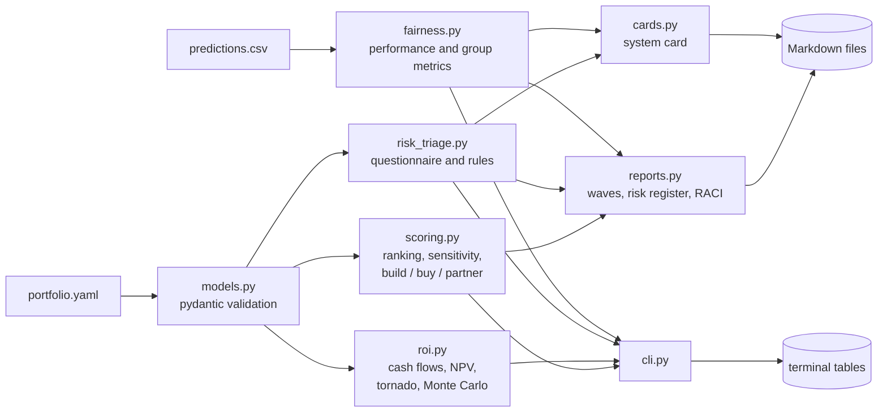

# Architecture

## Overview

The toolkit is a set of pure functions around two inputs: a portfolio YAML file and an optional
prediction CSV. The CLI is a thin layer that loads the inputs, calls the functions and prints tables
or writes Markdown. There is no state, no database and no network access.

## Data model

- `Portfolio`: name, `fictional` flag, currency, `ScoringConfig`, list of `UseCase`.
- `ScoringConfig`: scale, dimension weights, criteria (name, dimension, weight).
- `UseCase`: scores per criterion, optional `depends_on`, `build_buy`, `economics`, `triage` answers
  and the organisation role (provider or deployer).
- `Economics`: horizon, discount rate, cost and benefit inputs, adoption curve, uncertainty ranges.

Validation happens once at load time: unknown or missing criteria, scores outside the scale,
duplicate ids, unknown dependencies and unknown uncertainty drivers are rejected with a clear message.

## Design decisions

1. **Rules, not a model, for the risk triage.** A screening aid for a regulated topic has to be
   explainable line by line. Every tier decision is traced to a question id and an article reference,
   and the source of each answer (explicit or keyword match) is shown. An LLM classifier would be
   harder to audit and is out of scope.
2. **Explicit answers override keyword inference.** Keyword hits only pre-fill unanswered questions.
   A workshop answer of "no" always wins, so the tool cannot overrule the people in the room.
3. **Precedence order is fixed.** Prohibited beats high-risk, high-risk beats limited. Transparency
   obligations are still listed for high-risk systems because they apply in addition.
4. **The derogation is conservative.** The Art. 6(3) derogation is only considered for Annex III
   areas, needs at least one of the four conditions answered yes, and is blocked by profiling.
   When applied, the documentation and registration duties are added to the checklist.
5. **Risk is a separate dimension that is inverted.** Risk criteria are scored "5 means high risk",
   which is how workshop participants think. The inversion happens in one place (`overall_score`).
6. **Sensitivity has two views.** One-at-a-time shifts answer "what if the sponsor insists on more
   weight for value". The Dirichlet simulation answers "how often does this ranking hold if we are
   roughly right about the weights". The switch point gives the smallest shift that changes rank 1.
7. **Vectorised Monte Carlo with fixed seeds.** Both simulations use `numpy.random.default_rng(seed)`
   and draw in a fixed order, so results are reproducible and testable.
8. **Small dependency set.** numpy, pydantic and PyYAML. Metrics such as ROC AUC and Kendall tau are
   implemented directly (about 20 lines each) and tested against hand-computed values, instead of
   adding scikit-learn and scipy as dependencies.
9. **Reports are derived, not hand-written.** Waves, the risk register and the RACI are computed from
   the ranking, the tiers and the scores, so they stay consistent when an input changes.

## Extension points

- New criteria or weights: edit the `scoring` section of the YAML file, no code change.
- New triage questions: add a `Question` to `QUESTIONS` in `risk_triage.py` with tier and reference.
- New report: add a function to `reports.py` and register it in `build_reports`.
