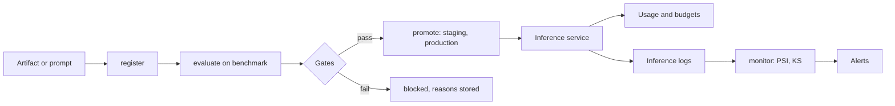

# llmops-eval-gate-pipeline

A minimal LLMOps platform core: a file-based model and prompt registry with stage promotion,
automated evaluation gates that block promotion on regressions, drift monitoring, inference
cost and latency tracking with token budget governance, a CPU model optimisation benchmark
(float32 ONNX versus int8 ONNX), a CLI, a CI eval-gate workflow and a FastAPI inference service
with Kubernetes manifests. It runs offline on CPU.

## What it is

The repository implements the control points of a model release process as small, testable
Python modules and one CLI:

```text
llmops register   store a model artifact or a prompt template as a new immutable version
llmops evaluate   run the benchmark, apply the gates, record the decision on the version
llmops promote    move a version to staging or production, refused unless the gate passed
llmops monitor    compare two windows of inference logs for drift and raise alerts
llmops list       show versions, stages and gate results
llmops benchmark  measure float32 vs int8 ONNX accuracy, size and latency on CPU
```

Exit codes are meaningful (0 ok, 1 gate failed or promotion blocked, 2 critical drift or usage
error), so each command works as a CI step.

## Background

Reference implementation by the author of MLOps and LLMOps platform work on Azure (model
lifecycle, evaluation before release, monitoring and cost control), done as Microsoft AI
Consultant and Azure Solutions Architect Expert and as co-founder of AsetraAI. This repository
is an independent, cloud-neutral illustration of those patterns. It is not code from any
employer or customer and uses only synthetic or public data.

Author: M. Emad Dwedar (AI researcher at TUM Heilbronn, co-founder of AsetraAI, Microsoft AI
Consultant, Azure Solutions Architect Expert).

## Features

- **Registry** (`registry.py`): versioned models and prompts on the file system, SHA-256 content
  hashes with artifact verification, stages `none`, `staging`, `production`, `archived`,
  validated transitions, automatic archiving of the previous production version, rollback,
  append-only history with actor and override reason.
- **Evaluation** (`evaluation.py`): benchmark datasets in JSONL, accuracy, macro F1, latency
  p50 and p95, token counts and cost per 1000 requests, for an ONNX classifier
  (onnxruntime) and for prompt plus LLM pairs behind a provider interface.
- **Gates** (`gates.py`): YAML thresholds with absolute limits and absolute or relative
  regression limits against the production version or a baseline file.
- **Drift monitoring** (`drift.py`): PSI and two-sample KS tests on score distributions,
  categorical PSI on predicted labels, embedding drift (KS on principal components with
  Bonferroni correction, centroid distance PSI), alert rules with warning and critical levels.
- **Cost governance** (`cost.py`): pricing table, usage tracking to JSONL, per-team and
  per-model summaries, monthly token and USD budgets with allow, downgrade and deny decisions.
- **Optimisation benchmark** (`optimize.py`): scikit-learn MLP exported with skl2onnx,
  dynamic int8 quantisation with onnxruntime, measured accuracy, agreement, size and latency.
- **Serving** (`service.py`): FastAPI service that loads the production version, verifies its
  hash, enforces budgets, meters usage and hot-reloads when a new version is promoted.
- **Delivery**: GitHub Actions workflows for lint, tests and the eval gate, a Dockerfile and
  Kubernetes manifests (validated syntactically only, see limitations).

## Quickstart

```bash
pip install -e ".[dev]"
make test         # pytest
make lint         # ruff
make demo         # full walkthrough, output below
make gate         # what the CI eval gate runs: train, register, evaluate against the baseline
make benchmark    # ONNX float32 vs int8 benchmark
```

Manual flow:

```bash
python examples/train_intent_model.py --out artifacts/candidate.onnx
llmops register model --name intent-classifier --artifact artifacts/candidate.onnx
llmops evaluate model --name intent-classifier \
       --dataset benchmarks/intent_benchmark.jsonl --gates benchmarks/gates.yaml
llmops promote model --name intent-classifier --to staging
llmops promote model --name intent-classifier --to production
LLMOPS_REGISTRY=.registry uvicorn llmops_gate.service:app --port 8080
curl -X POST localhost:8080/predict -H 'content-type: application/json' \
     -d '{"text": "I was overcharged on my invoice"}'
```

## Demo output

Excerpt of `make demo`, pasted from a real run in the authoring container (Python 3.13, 2 CPU
cores, onnxruntime 1.29, scikit-learn 1.9). The full output is about 260 lines, the omitted
part is marked. What the numbers are:

- Sections 1 to 4 use SYNTHETIC support tickets generated by `llmops_gate.datasets`.
- Model latencies in section 1 and all numbers in section 5 are real CPU measurements and
  change from run to run.
- In sections 2 and 4 the "LLM" is `KeywordMockLLM`, a deterministic keyword matcher. Its
  latency is simulated by a linear token model and the prices are illustrative example values,
  not any vendor's price list. These sections demonstrate the gate and budget mechanics, not
  model quality or real cost.

```text
--- v2: trained on a truncated export, 60 tickets
$ llmops register model --name intent-classifier --artifact <tmp>/artifacts/intent.onnx
registered model:intent-classifier:v2 sha256=710cc88c8f5b stage=none
[exit code 0]

$ llmops evaluate model --name intent-classifier --dataset benchmarks/intent_benchmark.jsonl --gates benchmarks/gates.yaml
evaluated model:intent-classifier:v2 on 400 examples
  accuracy                  0.69
  macro_f1                  0.6897
  latency_p50_ms            0.0169
  latency_p95_ms            0.034
  mean_input_tokens         15.88
  cost_per_1k_requests_usd  0.000159
baseline: model:intent-classifier:v1
  FAIL  accuracy 0.69 >= min 0.8
  FAIL  accuracy 0.69 vs baseline 0.8625: regression 0.1725 (allowed 0.02)
  FAIL  macro_f1 0.6897 >= min 0.78
  FAIL  macro_f1 0.6897 vs baseline 0.8633: regression 0.1736 (allowed 0.02)
  PASS  latency_p95_ms 0.034 <= max 5
  PASS  cost_per_1k_requests_usd 0.000159 <= max 0.01
GATE: FAILED
[exit code 1]

$ llmops promote model --name intent-classifier --to staging
PROMOTION BLOCKED: model:intent-classifier:v2 failed the evaluation gate: accuracy 0.69 >= min 0.8; accuracy 0.69 vs baseline 0.8625: regression 0.1725 (allowed 0.02); macro_f1 0.6897 >= min 0.78; macro_f1 0.6897 vs baseline 0.8633: regression 0.1736 (allowed 0.02)
[exit code 1]

[... v3 and the three prompt versions follow the same pattern, omitted here ...]

$ llmops list
model:intent-classifier:v1        archived    gate=pass  accuracy=0.8625
model:intent-classifier:v2        none        gate=fail  accuracy=0.6900
model:intent-classifier:v3        production  gate=pass  accuracy=0.8525
prompt:intent-prompt:v1           archived    gate=pass  accuracy=0.8350
prompt:intent-prompt:v2           none        gate=fail  accuracy=0.6575
prompt:intent-prompt:v3           production  gate=pass  accuracy=0.8350
[exit code 0]

==============================================================================
3. Drift monitoring on inference logs of the production model
==============================================================================
logs produced by model:intent-classifier:v3; the shifted window has a different class mix,
more keyword noise and vocabulary that was never seen in training

$ llmops monitor --reference <tmp>/reference.jsonl --current <tmp>/current_stable.jsonl --rules benchmarks/alert_rules.yaml
drift status: OK (reference n=600, current n=600)
  score_psi                   0.0367
  score_ks_statistic          0.035
  score_ks_pvalue             0.856
  mean_score_drop             0.0042
  label_psi                   0.0095
  centroid_cosine_distance    0.005768
  drifted_component_share     0
  max_component_ks            0.065
  centroid_distance_psi       0.0186
  latency_p95_ratio           0.6347
[exit code 0]

$ llmops monitor --reference <tmp>/reference.jsonl --current <tmp>/current_shifted.jsonl --rules benchmarks/alert_rules.yaml
drift status: CRITICAL (reference n=600, current n=600)
  score_psi                   0.565
  score_ks_statistic          0.2883
  score_ks_pvalue             2.22e-22
  mean_score_drop             0.1274
  label_psi                   0.1666
  centroid_cosine_distance    0.404432
  drifted_component_share     1
  max_component_ks            0.2233
  centroid_distance_psi       3.9558
  latency_p95_ratio           0.6602
  ALERT [critical] score_psi=0.565 is above 0.25
  ALERT [warning] label_psi=0.1666 is above 0.1
  ALERT [critical] centroid_distance_psi=3.9558 is above 0.25
  ALERT [critical] drifted_component_share=1 is above 0.5
  ALERT [critical] mean_score_drop=0.1274 is above 0.08
  ALERT [critical] score_ks_pvalue=2.22e-22 is below 0.0001
[exit code 2]


==============================================================================
4. Cost and latency tracking with token budget governance
==============================================================================
prices are illustrative example values, latency comes from the mock's linear model

team            allow  downgrade  deny
support-bot       216        113    71
analytics         100          0     0

team           requests  in tokens  cost USD  USD/1k req   p50 ms   p95 ms
analytics           100      18079    0.0926      0.9257    183.3    184.8
support-bot         329      59484    0.2060      0.6262    183.3    185.1

model          requests  in tokens  cost USD  USD/1k req   p50 ms   p95 ms
large-llm           316      57111    0.2923      0.9249    183.3    185.1
small-llm           113      20452    0.0063      0.0560    183.3    184.9

support-bot: 59949 of 60000 tokens, 0.2060 of 0.25 USD used
analytics: 18224 of 2000000 tokens, 0.0926 of 20.00 USD used

==============================================================================
5. Model optimisation benchmark (real CPU measurements)
==============================================================================
dataset: scikit-learn digits (1797 samples, 64 features, 10 classes); train 1257, test 540; MLP hidden [256, 128]; onnxruntime CPU, 1 thread(s)
variant              accuracy   agree  size kB   p50 ms   p95 ms  batch ms    rows/s
sklearn-mlp            0.9796  1.0000      n/a   0.1378   0.2592     0.878    614768
onnx-float32           0.9796  1.0000    199.8   0.0096   0.0123     0.397   1359029
onnx-int8-dynamic      0.9796  1.0000     54.6   0.0129   0.0164     0.246   2192386
```

Reading the optimisation table: dynamic int8 quantisation reduced the model file from 199.8 kB
to 54.6 kB with identical test accuracy and 100 percent prediction agreement on this model.
Single-row inference was slower with int8 than with float32 in every run made in this container
(p50 0.0129 ms versus 0.0096 ms in the run above), because the per-call quantise and dequantise
steps outweigh the cheaper integer matmul for one row. Batch inference over the 540 test rows
was faster with int8 in each of seven runs, but the margin ranged from about 3 to 45 percent,
so the size of that gain is not stable. The reliable result for a model this small is the size
reduction.

## Architecture

See [docs/architecture.md](docs/architecture.md) for the full component diagram, the promotion
state machine and the design decisions.



## Tests

```bash
make test
```

79 test cases (pytest, including parametrised cases), about 4 seconds on the authoring machine.
They train two small models once per session and cover: registry versioning, hashing, stage
transitions, blocked promotion, override and rollback, gate arithmetic for absolute and
relative rules, evaluation metrics against hand-computed values, PSI against hand-computed
values, KS and embedding drift on controlled shifts, alert rules, budget decisions including
month rollover, the quantisation benchmark (int8 graph contains `MatMulInteger`, file is
smaller, predictions agree), CLI exit codes, the FastAPI service (readiness, metering, 429 on
budget exhaustion, hot reload, hash mismatch) and consistency of the Kubernetes manifests.

## Limitations

- **No real LLM was called.** Prompt evaluation and cost governance run against
  `KeywordMockLLM`. Accuracy differences between prompt versions are real consequences of the
  prompt text for that keyword matcher, and say nothing about how an actual LLM would respond.
- **The Azure OpenAI and OpenAI adapter is untested.** `OpenAIChatProvider` was never executed
  because the authoring environment has no model endpoint or credentials.
- **Prices are illustrative** and the mock's latency is simulated.
- **Kubernetes manifests were validated only syntactically**: parsed with PyYAML and
  cross-checked for consistent selectors, ports, volumes and probe paths in
  `tests/test_deploy.py`. They were not applied to a cluster and not checked with
  `kubectl --dry-run` or a schema validator. **The Dockerfile was not built** (no Docker
  daemon available).
- **The GitHub Actions workflows were not executed on GitHub.** Their YAML parses and the
  commands they run were executed locally (`make gate`, `ruff`, `pytest`).
- **Embeddings are feature hashes**, not a learned embedding model. Embedding drift here means
  vocabulary drift.
- **The intent classifier is a toy** (MLP on hashed bag-of-words, synthetic data, 86 percent
  accuracy on the synthetic benchmark). It exists to give the gates something real to measure.
- **Only dynamic int8 quantisation is benchmarked**, on one small model, on one machine.
  Results will differ for other models and CPUs.
- **Single-node assumptions**: the registry has no locking, and usage metering is in-process,
  so budgets are enforced per replica, not globally.
- The baseline metrics used by the CI gate were produced with the library versions listed
  above. Other versions can shift the trained model slightly, the regression tolerance is 0.02.

## License

MIT, see [LICENSE](LICENSE). Copyright (c) 2026 M. Emad Dwedar.
