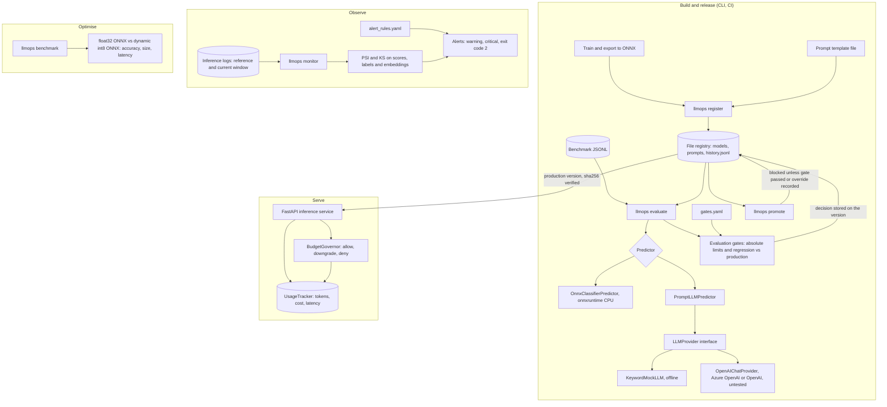
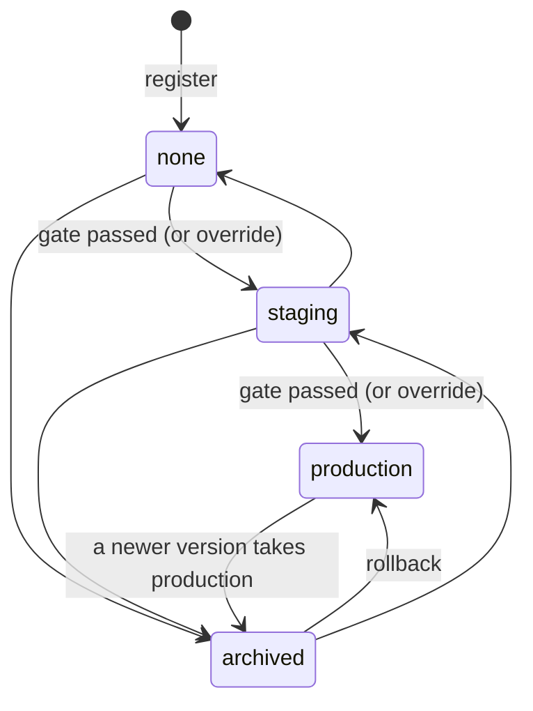

# Architecture

## Component view

## Promotion state machine

## Design decisions

**Files instead of a database.** A version is a directory with `meta.json` and the artifact.
Metadata is written with temp-file-plus-rename so a crash never leaves a half-written entry.
This keeps the registry inspectable with `ls` and `cat`, diffable, and usable as a CI artifact.
The cost is that there is no locking: two concurrent registrations of the same name can collide.

**The gate decision lives on the version.** `evaluate` stores metrics and the full list of
checks in the entry. `promote` only reads that record. Evaluation and promotion can therefore
run in different jobs, and the reason a version was blocked stays attached to it.

**Two kinds of gate checks.** Absolute limits (`min`, `max`) always apply, so the first version
of a model is still held to a floor. Regression limits (`max_regression`,
`max_regression_pct`) compare with the current production version, or with an explicit baseline
file when the registry is not persisted (the CI workflow uses that).

**Latency gates are absolute for measured latency.** The ONNX predictor reports real wall-clock
latency, which varies between machines and runs. A relative check against a stored number would
make CI flaky, so the model gate uses a generous absolute budget. Prompt evaluations with the
mock provider use a deterministic simulated latency, where a relative check is meaningful as a
guard on prompt length.

**Overrides exist and leave a trace.** A failed gate can be bypassed only with
`--override-reason`, which is written to `history.jsonl` with the actor. Blocking without any
escape hatch tends to get the gate removed during the first incident.

**Prompts are release artifacts.** A prompt template gets versions, hashes, stages and gate
results exactly like a model. Variables are extracted at registration and rendering fails on
missing or unexpected variables.

**Drift is measured three ways.** Score distribution (PSI, KS), predicted label mix
(categorical PSI) and input embeddings (KS on the top principal components with Bonferroni
correction, PSI of the distance to the reference centroid). Input drift can be detected without
labels, which is the normal situation in production.

**Budget governance happens before the call.** The governor projects the request onto the
team's monthly token and USD budget and returns allow, downgrade (route to a cheaper model above
the soft limit) or deny. Teams without a budget are denied.

**The optimisation benchmark reports what was measured.** For the small MLP used here, int8
dynamic quantisation cuts the file size by a factor of about 3.7 and keeps accuracy, but single-row
inference is slower than float32 in the measured runs and only batch inference gets faster.
The table is printed as measured instead of being tuned to look favourable.

## What is deliberately left out

- Experiment tracking, lineage across data sets, and model cards.
- A shared metering store. Usage is kept per process, so budgets are per replica.
- Canary or shadow deployment and automated rollback triggers from the drift monitor.
- Static (calibration-based) quantisation, pruning and distillation.
- Authentication on the inference service.
