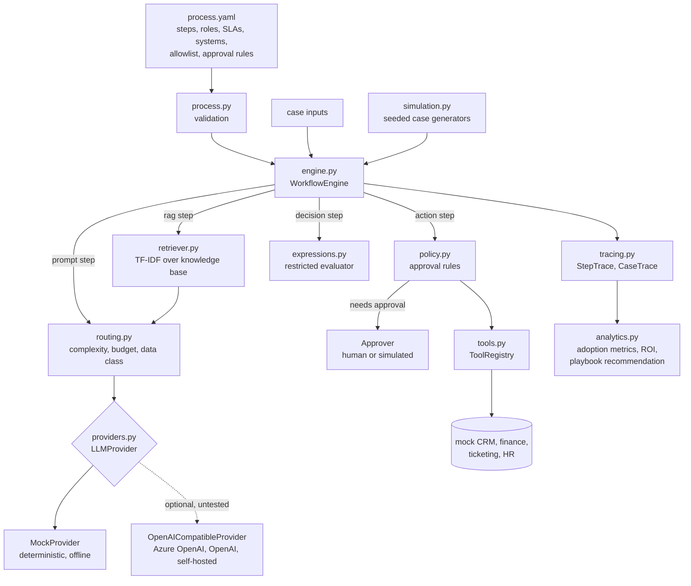

# Architecture

## Overview

A process is data (YAML). The engine walks its steps, keeps a context dictionary that later steps
read from, and writes one trace entry per step. LLM calls go through a router and a provider
interface, tool calls go through an allowlist and an approval policy. Analytics are computed from
the traces only.

## Step types

| Type | What the engine does | What can stop it |
|---|---|---|
| `prompt` | Renders prompt and input, routes to a model, calls the provider, stores structured output in the context | Confidence below `min_confidence` after the cascade, budget |
| `rag` | Retrieves top-k chunks with TF-IDF, asks the model for an answer grounded on them, stores answer, sources and confidence | No passage, low confidence, budget |
| `action` | Renders arguments, checks the allowlist, evaluates approval rules, asks the approver, calls the tool | Approval denied or no approver, tool error |
| `decision` | Evaluates branch conditions in order, jumps to the first match or the default | Invalid expression |
| `human` | Records the manual handling time and continues | Nothing |

Prompt chaining is the combination of the first two rows with the context: a classification feeds a
decision, an extraction feeds a tool call, a retrieved policy feeds a draft.

## Design decisions

1. **Fail closed.** Every abnormal situation (low confidence, denied or missing approval, tool
   error, unresolved template, exhausted budget, step loop) ends the automated run with a handoff
   to a person and a reason in the trace. No approver configured means approvals are denied.
2. **Side effects only through allowlisted tools.** A process must list the tools it may call
   (`allowed_tools`). The file fails validation if a step uses another tool, and the engine checks
   again at run time.
3. **Approval is policy, not code.** Rules live in the process file (`tool`, `when`, `approver_role`,
   `review_minutes`). The engine asks an `Approver` object, so a UI, a queue or a simulated reviewer
   can be plugged in without touching the workflow.
4. **No `eval`.** Conditions are parsed with `ast` and interpreted by a whitelist evaluator
   (comparisons, boolean logic, arithmetic, five pure functions, dictionary attribute access).
5. **Routing is rule-based and explainable.** Hosting follows the data classification of the step
   (confidential data stays on the self-hosted open-source models). The tier follows a complexity
   score. The case budget can downgrade a step. The reason string is stored in the trace.
6. **Cascade on low confidence.** A step with `min_confidence` that fails on the cheap model is
   retried once on the strong model of the same hosting if the budget allows it. Both calls are
   accounted in the trace.
7. **The mock is honest about what it is.** `MockProvider` implements the four tasks with keyword
   matching, regular expressions and sentence selection. Its two tiers differ by documented rules
   so that routing and cascading change results. It makes the control flow testable, it says
   nothing about real model quality. Latency is computed from a per-model formula, not measured.
8. **Analytics come from traces.** The simulation runs generated cases through the real engine.
   Automation rate, intervention rate, handling time and cost are derived from the recorded steps,
   not from separately invented numbers. Inputs that are assumptions (case mix, manual minutes,
   labour rate, prices) are labelled as such.
9. **Paired before and after.** The baseline of a case is the manual time of the steps that this
   case visited, so both sides of the comparison refer to the same work.

## Baseline and handoff accounting

- Each step declares `manual_minutes`, its handling time in the manual process.
- Before: sum of `manual_minutes` of the visited steps. For a handoff, `handoff_manual_minutes` is
  added because a person still has to finish the case.
- After: approval review time, manual steps, and `handoff_manual_minutes` for handoffs.
- Queue and waiting time are not modelled. SLA checks compare handling time plus model latency with
  the SLA of the step and of the process.

## Extension points

- New process: add a YAML file. New tool: `registry.register(name, fn, system, side_effect)`.
- Real models: pass `providers={"proprietary": OpenAICompatibleProvider.from_env(), ...}` and a
  catalog with real model names and prices to `ModelRouter`.
- Real approvals: implement `Approver.decide`.
