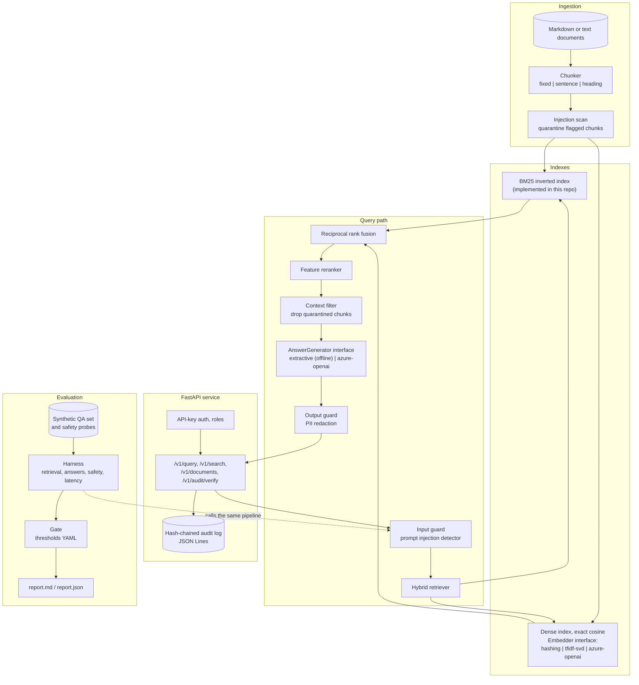
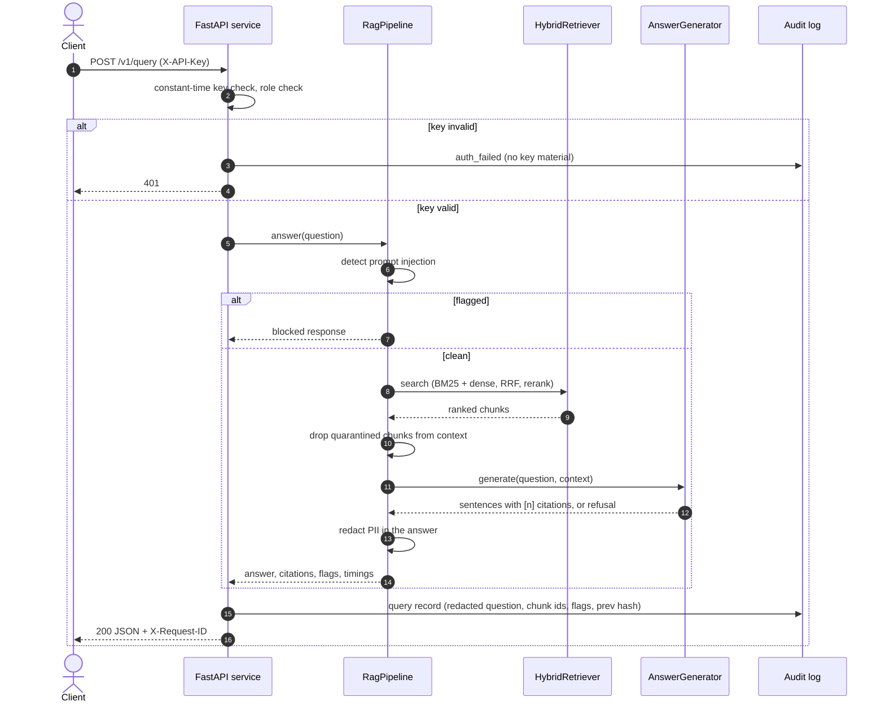

# Architecture

rag-eval-kit has two halves that share one pipeline object: a service that answers questions over
an indexed corpus, and an evaluation harness that measures that same pipeline and applies a gate.
Evaluating the object that is deployed, not a copy of its logic, is the main structural decision.

## Components

## Request sequence

## Module map

| Module | Responsibility |
| --- | --- |
| `text.py` | Tokeniser, light stemmer, sentence splitter |
| `documents.py` | `Document`, `Chunk`, markdown corpus loader |
| `chunking.py` | Fixed window, sentence and heading chunkers |
| `bm25.py` | Okapi BM25 on an inverted index |
| `embeddings.py` | `Embedder` protocol, hashing and TF-IDF/SVD embedders, Azure OpenAI adapter |
| `retrieval.py` | Dense index, reciprocal rank fusion, feature reranker, `HybridRetriever` |
| `generation.py` | `AnswerGenerator` protocol, extractive generator, prompt builder, citation parser, Azure OpenAI adapter |
| `safety.py` | PII detection and redaction, prompt injection scoring |
| `audit.py` | Hash-chained append-only audit log |
| `pipeline.py` | `RagPipeline`: ingest, guard, retrieve, generate, redact |
| `service.py` | FastAPI application factory, API keys, roles |
| `evaluation/metrics.py` | recall@k, MRR, nDCG, percentiles, groundedness, citation metrics |
| `evaluation/harness.py` | Runs all measurements and builds the report |
| `evaluation/report.py` | Gate and markdown rendering |
| `cli.py` | `rag-eval-kit eval`, `query`, `serve` |

## Design decisions

### 1. Two provider interfaces, offline implementations as defaults

Embedding and generation sit behind `Embedder` and `AnswerGenerator`. The defaults are
deterministic and run on CPU without a model download, so tests, CI and the demo need no network.
The Azure OpenAI adapters use only the standard library and environment variables. They are not
exercised by the tests. Their prompt builder and citation parser are pure functions and are tested.

Consequence: the offline numbers describe the lexical baseline, not what a neural embedding model
or an LLM would achieve. The harness is the tool to measure that difference on your own data.

### 2. BM25 implemented in the repository

The sparse index is about 60 lines and has a hand-computed test. Keeping it in the repository
removes a dependency and makes the scoring function inspectable, which matters when a customer
asks why a document ranked where it did.

### 3. Rank fusion instead of score fusion

BM25 scores and cosine similarities live on different scales and their distributions change with
the corpus. Reciprocal rank fusion uses ranks only, so there is nothing to calibrate when the
embedder is swapped.

### 4. Relevance labels at document level

The QA set labels relevant documents, not chunks. Metrics deduplicate retrieved chunks to documents
first. This makes the same labels valid for every chunking strategy, which is what allows the
chunking comparison. The cost is that the metrics cannot tell whether the right passage inside the
right document was found. The key phrase check on the answer covers part of that gap.

### 5. Refuse rather than guess

The extractive generator returns a fixed refusal when no sentence covers enough of the question's
informative terms. On the bundled set this refuses every unanswerable question and also most
paraphrased questions, because paraphrases share few terms with the source by construction. The
trade-off is explicit and measured (answer rate by question kind) instead of hidden.

### 6. Guardrails at three points

Input (block prompt injection), context (retrieved chunks flagged at ingest are kept out of the
generator context) and output (redact personal data). The context guard exists because an
extractive or generative model can repeat instructions planted in a document. The evaluation runs
the indirect injection probes with and without the quarantine to show the effect.

### 7. Audit log with a hash chain

Each record contains the hash of the previous record. Editing or deleting a line is detected by
`verify()`. Questions are stored after PII redaction, API keys are never stored. The chain gives
tamper evidence, not tamper protection: production deployments should forward records to an
append-only store.

### 8. The gate reads metric paths from a YAML file

A check is `{metric, op, threshold}` with a dotted path into the report. A missing metric fails the
check, so a renamed metric cannot silently disable a gate. The process exit code is the gate
result, which is what a CI pipeline needs.

## What a production deployment would change

- Replace the offline embedder and generator with the Azure OpenAI adapters or other providers, and
  re-run the evaluation on a labelled sample of the customer's own questions.
- Replace exact cosine search with an approximate index or a managed vector store beyond roughly
  100,000 chunks.
- Persist the indexes. The current pipeline rebuilds them in memory on start and on every ingest.
- Put the service behind a gateway with TLS, rate limiting and an identity provider. API keys are
  a minimal mechanism.
- Add document-level access control to retrieval. The current service has no per-user filtering.
