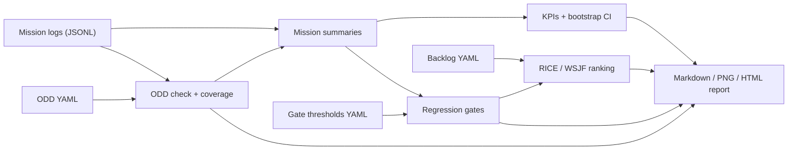

# robot-autonomy-kpi-toolkit

A product-ops toolkit for robot autonomy. It turns mission logs into the artefacts a technical
product manager needs for a release decision: an Operational Design Domain (ODD) check, KPIs
with confidence intervals, statistical regression gates between two builds, a prioritised backlog
linked to the KPIs, and a release-readiness report.

**All mission logs shipped with or produced by this repository are synthetic.** They come from a
seeded generator and are labelled `"synthetic": true`. There is no field data here, and the
numbers below describe the toolkit's behaviour on generated logs only.

## Background

Reference implementation by the author, M. Emad Dwedar, drawing on two parts of his own work:
doctoral research at TUM Heilbronn on autonomy for legged, aerial and ground robots, in which a
reachability-based safety gate decides whether a proposed command is published to the robot or
withheld, and product ownership as a co-founder of AsetraAI. The log format (commands proposed,
published or withheld by a gate) and the KPI set follow that way of working.

This repository is not the research code, contains no research or customer logs, and does not
implement the reachability computation. It measures and reports what a gate and an autonomy stack
did, given their logs.

## Features

- **ODD specification**: YAML schema for environment, terrain (with slope limit), lighting, speed
  and connectivity limits. Validator that reports all problems at once.
- **ODD checks for mission logs**: per-mission violations merged into time spans, share of
  autonomous time inside the ODD, and coverage of the ODD cells (environment x terrain x
  lighting band) by in-ODD missions.
- **Mission log format**: JSONL events for commands proposed, published and withheld by a safety
  gate, state samples (localisation error, separation distance, battery, lighting, latency,
  slope), interventions, faults and mission outcome. Structural validation per mission.
- **Synthetic log generator**: seeded, with build profiles for a baseline, an improved and a
  regressed candidate.
- **KPIs**: mission success rate, interventions per hour and per km, mean distance between
  interventions, safety-gate withhold rate, minimum separation, autonomy uptime, mean
  localisation error, faults per hour. Each with a mission-level bootstrap confidence interval.
- **Release regression gates**: candidate against baseline with configurable tolerances and
  absolute limits, Fisher's exact test, an exact Poisson rate test and the Mann-Whitney U test,
  and PASS / WARN / FAIL verdicts. The CLI returns exit code 1 on FAIL for use in CI.
- **Prioritisation**: RICE and WSJF over a backlog YAML whose items name the KPIs they move.
  Items that address KPIs with failing gates are marked and can be boosted.
- **Reports**: Markdown release-readiness report, KPI dashboard as PNG and as a self-contained
  static HTML page.
- **Docs**: an example PRD, a roadmap and a KPI glossary that a test keeps in sync with the code.

## Quickstart

```bash
python -m venv .venv && source .venv/bin/activate
make install        # pip install -e ".[dev]"
make test
make demo           # python examples/run_demo.py, writes examples/out/
```

Command line:

```bash
autonomy-kpi generate --profile baseline  --missions 80 --seed 11 --out base.jsonl
autonomy-kpi generate --profile regressed --missions 80 --seed 11 --out cand.jsonl
autonomy-kpi validate-odd examples/odd_ground_legged_v1.yaml
autonomy-kpi kpis base.jsonl --odd examples/odd_ground_legged_v1.yaml
autonomy-kpi gate   --baseline base.jsonl --candidate cand.jsonl \
                    --gates examples/gates.yaml --odd examples/odd_ground_legged_v1.yaml
autonomy-kpi report --baseline base.jsonl --candidate cand.jsonl \
                    --gates examples/gates.yaml --odd examples/odd_ground_legged_v1.yaml \
                    --backlog examples/backlog.yaml --out out
autonomy-kpi prioritise examples/backlog.yaml --method wsjf
```

## Demo output

Output of `python examples/run_demo.py` in the build container (Python 3.13, numpy 2.5, scipy,
seed 11, 80 synthetic missions per build). Shortened: the lines listing report paths, the
repeated baseline line and the second KPI table are left out. The run is deterministic.

```text
NOTE: all mission logs in this demo are SYNTHETIC (seeded generator, not field data).

== 1. Synthetic mission logs ==
v1.4.0     : 80 missions, 74868 events, malformed: 0
v1.5.0-rc1 : 80 missions, 75257 events, malformed: 0
v1.5.0-rc2 : 80 missions, 77295 events, malformed: 0

== 2. ODD 'campus-and-site-patrol' v1.0 ==
lighting bands in ODD: ['dim', 'bright_indoor', 'daylight']

== 3. Release check: v1.5.0-rc1 vs v1.4.0 ==
v1.4.0     : 58/80 missions inside ODD, cells covered 16/27, violation spans {'connectivity': 1, 'lighting': 9, 'slope': 30, 'terrain': 13}
v1.5.0-rc1 : 64/80 missions inside ODD, cells covered 13/27, violation spans {'lighting': 26, 'slope': 11, 'terrain': 6}
KPI                                      baseline [95% CI]            candidate [95% CI]
mission_success_rate                     0.879 [0.793, 0.948]         0.953 [0.891, 1]
interventions_per_hour                   1.13 [0.546, 1.85]           1.26 [0.705, 1.89]
interventions_per_km                     0.322 [0.156, 0.528]         0.36 [0.202, 0.543]
mean_distance_between_interventions_km   3.11 [1.9, 6.39]             2.78 [1.84, 4.96]
gate_withhold_rate                       0.0213 [0.0173, 0.025]       0.0201 [0.0167, 0.0238]
min_separation_m                         0.359 [0.359, 0.383]         0.353 [0.353, 0.41]
autonomy_uptime                          0.969 [0.963, 0.974]         0.963 [0.953, 0.971]
localisation_error_mean_m                0.0779 [0.0725, 0.084]       0.0708 [0.0667, 0.0751]
faults_per_hour                          1.53 [0.909, 2.28]           0.978 [0.422, 1.56]
gates:
  PASS mission_success_rate                     regression    -8.4 % p=0.9666 (fisher)
  PASS interventions_per_hour                   regression   +11.6 % p=0.4493 (poisson_rate)
  PASS mean_distance_between_interventions_km   regression   +10.6 % p=0.4472 (poisson_rate)
  PASS gate_withhold_rate                       regression    -5.3 % p=0.6887 (mann_whitney)
  PASS min_separation_m                         regression    +1.7 % p=0.2542 (mann_whitney)
  PASS autonomy_uptime                          regression    +0.6 % p=0.6440 (mann_whitney)
  PASS localisation_error_mean_m                regression    -9.1 % p=0.9779 (mann_whitney)
overall verdict: PASS

== 3. Release check: v1.5.0-rc2 vs v1.4.0 ==
v1.5.0-rc2 : 63/80 missions inside ODD, cells covered 15/27, violation spans {'connectivity': 1, 'lighting': 6, 'slope': 26, 'terrain': 12}
[KPI table omitted here, see examples/out/v1.5.0-rc2/release_readiness.md after running the demo]
gates:
  WARN mission_success_rate                     regression    +6.1 % p=0.2831 (fisher)
  FAIL interventions_per_hour                   regression  +222.7 % p=0.0000 (poisson_rate)
  FAIL mean_distance_between_interventions_km   regression   +70.6 % p=0.0000 (poisson_rate)
  FAIL gate_withhold_rate                       regression  +176.1 % p=0.0000 (mann_whitney)
  PASS min_separation_m                         regression    +1.4 % p=0.3778 (mann_whitney)
  FAIL autonomy_uptime                          regression    +6.1 % p=0.0000 (mann_whitney)
  FAIL localisation_error_mean_m                regression   +62.5 % p=0.0000 (mann_whitney)
overall verdict: FAIL

== 4. Backlog prioritisation (gates not passing on v1.5.0-rc2) ==
KPIs with WARN or FAIL: ['mission_success_rate', 'interventions_per_hour', 'mean_distance_between_interventions_km', 'gate_withhold_rate', 'autonomy_uptime', 'localisation_error_mean_m']
RICE order: AUT-102 (160.0), AUT-106 (160.0), AUT-103 (140.0), AUT-107 (90.0), AUT-104 (87.5), AUT-101 (28.8), AUT-105 (12.0)
WSJF order: AUT-106 (7.7), AUT-102 (5.8), AUT-103 (3.7), AUT-104 (3.2), AUT-107 (3.0), AUT-101 (2.0), AUT-105 (1.4)
WSJF with gate boost 1.5: AUT-106 (11.5), AUT-102 (8.7), AUT-103 (5.5), AUT-104 (4.9), AUT-107 (4.5), AUT-101 (3.0), AUT-105 (2.1)
```

How to read this honestly:

- The generator gives `v1.5.0-rc1` a lower true intervention rate than the baseline (1.0 against
  1.5 per hour in the profile). With about 60 in-ODD missions per build the measured rates come
  out as 1.26 against 1.13, with wide overlapping intervals. The gates pass, but the data cannot
  show the improvement. That is a property of the sample size, and the toolkit reports it instead
  of hiding it.
- `v1.5.0-rc2` has a much higher intervention rate, a more conservative gate and worse
  localisation in its profile. Five gates fail. The success-rate drop exceeds the 5 % tolerance
  but is not significant (p = 0.28), so it is a WARN, not a FAIL.
- About a quarter of the generated missions fall outside the example ODD (stairs, or lighting
  below 50 lux) and are excluded from the KPIs.

## Architecture



A sample of the generated report for the failing candidate is checked in under
[docs/sample_report/](docs/sample_report/) (synthetic data).

Module responsibilities, the log format and the design decisions are in
[docs/architecture.md](docs/architecture.md). Product documents:
[docs/kpi_glossary.md](docs/kpi_glossary.md),
[docs/prd_stair_traversal.md](docs/prd_stair_traversal.md),
[docs/roadmap.md](docs/roadmap.md).

## Tests

`pytest` runs 41 tests in under 10 seconds. They cover event schema errors, JSONL round trip,
generator determinism, structural validation of every generated mission, exact KPI values on
hand-built missions, bootstrap behaviour (reproducible, narrows with more missions, edge cases),
ODD validation messages, violation spans, coverage counting, each statistical test's direction,
all verdict branches of the gates, RICE and WSJF formulas and tie handling, report content, the
PNG and HTML dashboard, glossary and code consistency, and the CLI end to end including the exit
code on FAIL. CI (`.github/workflows/ci.yml`) runs `ruff check` and `pytest`.

## Limitations

- Synthetic data only. The generator is a set of random processes with hand-chosen parameters,
  not a robot simulator. KPI values in this README say nothing about any real robot or product.
- No importer for real robot logs (rosbag2, MCAP). Real data has to be converted to the JSONL
  event format first.
- The log format assumes that localisation error and separation distance are available in the
  log. On a real robot both need a reference (motion capture, surveyed map, a perception stack
  that is itself imperfect).
- No correction for multiple comparisons across gates, and no sequential testing. Running many
  gates or peeking repeatedly raises the false alarm rate above `alpha`.
- The Poisson rate test assumes events arrive independently. Interventions that cluster (one bad
  site) make its p-values too small. The bootstrap intervals do account for mission-level
  clustering, the rate test does not.
- The bootstrap interval of `min_separation_m` is not reliable, as for any extreme-value
  statistic. Use the absolute limit.
- ODD coverage is a cross product of categories, so it lists cells that cannot occur (for example
  an indoor warehouse with grass). KPIs are fleet-level only, with no breakdown per terrain or
  platform.
- RICE and WSJF inputs in the example backlog are illustrative estimates.

## License

MIT, see [LICENSE](LICENSE). Copyright (c) 2026 M. Emad Dwedar.
