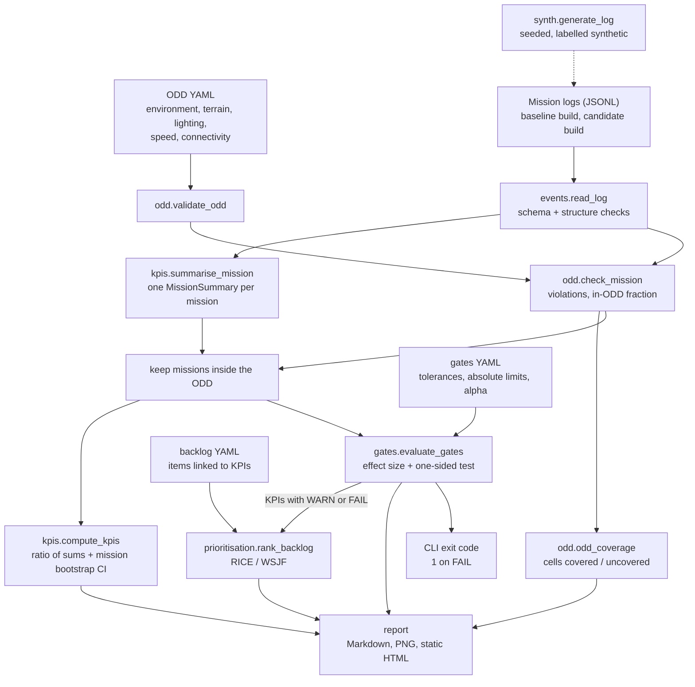

# Architecture

## Pipeline

## Modules

| Module | Responsibility |
| --- | --- |
| `events.py` | Event model, JSONL read and write, per-mission structural validation |
| `synth.py` | Seeded synthetic log generator with build profiles |
| `odd.py` | ODD schema, validator, per-mission ODD check, coverage over ODD cells |
| `kpis.py` | Mission summaries, KPI definitions (single source of truth), bootstrap intervals |
| `gates.py` | Gate configuration, statistical tests, verdict logic |
| `prioritisation.py` | Backlog schema, RICE and WSJF scores, ranking with KPI links |
| `report.py` | Analysis pipeline, Markdown report, PNG and HTML dashboard |
| `cli.py` | `autonomy-kpi` command line interface |

## Log format

One JSON object per line. Common fields: `mission_id`, `build`, `t` (seconds since mission start),
`type`.

| Type | Additional fields |
| --- | --- |
| `mission_start` | `platform`, `environment`, `terrain`, `planned_distance_m`, `synthetic` |
| `command_proposed` | `command_id`, `speed_mps` |
| `command_published` | `command_id` |
| `command_withheld` | `command_id`, `reason` |
| `state` | `mode`, `distance_m`, `speed_mps`, `localisation_error_m`, `separation_m`, `battery_soc`, `lighting_lux`, `link_latency_ms`, `slope_deg` |
| `intervention` | `kind`, `duration_s`, `cause` |
| `fault` | `code`, `severity` |
| `mission_end` | `outcome`, `distance_m`, `duration_s` |

The three command events model a safety gate between planner and actuators. The planner proposes,
the gate either publishes the command to the robot or withholds it with a reason. This mirrors
the structure of a reachability-based safety gate: a command is only forwarded if the states
reachable under it stay inside the safe set. The toolkit does not implement the reachability
computation. It measures what the gate did.

## Design decisions

1. **Mission as the unit of analysis.** KPIs are ratios of sums over missions and the bootstrap
   resamples missions. Samples inside a mission are correlated (one bad localisation episode
   produces many bad samples), so event-level resampling would understate uncertainty.
2. **KPI definitions in one table.** `KPI_DEFINITIONS` holds name, unit, direction and estimator.
   Gates, reports, backlog validation and the glossary test all read from it, so a KPI cannot be
   gated or referenced in a backlog unless it is defined.
3. **Gates combine effect size and evidence.** A tolerance alone fails builds on noise when there
   are few missions. A significance test alone fails builds on tiny but certain differences when
   there are many. FAIL requires both, WARN flags the cases where they disagree, and absolute
   limits act as hard floors independent of the baseline.
4. **Test chosen per KPI type.** Mission outcomes: Fisher's exact test. Event counts with an
   exposure: exact conditional Poisson rate test. Quantities sampled many times per mission:
   Mann-Whitney U on per-mission values, which avoids treating correlated samples as independent.
5. **ODD first, KPIs second.** With an ODD, only missions that stayed inside it count. Operation
   outside the ODD is reported separately as violations instead of silently lowering the KPIs.
   The 95 % in-ODD threshold tolerates isolated samples such as one latency spike.
6. **Coverage as a cross product of categorical cells.** Environment, terrain and lighting band
   form the cells. This is easy to read and shows where evidence is missing. It also lists cells
   that cannot occur in practice, which is a known limitation.
7. **Gate withholds exclude manual control.** While a human drives, planner commands are not
   forwarded. Counting those as gate withholds would mix operator behaviour into a metric meant
   to describe the gate.
8. **Reports are static files.** Markdown for the release ticket, PNG and a self-contained HTML
   page for sharing. No server, no JavaScript.
9. **Synthetic generator separate from the analysis.** The analysis modules never import
   generator internals except the vocabulary of environments, terrains and platforms. Real logs
   in the same JSONL format can replace the generator output without code changes.
