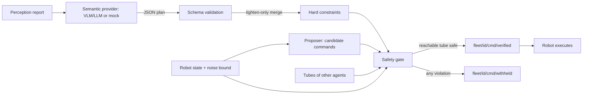

# safe-multirobot-reachability-gate

A safety gate for aerial-ground robot teams: a language model may propose constraints
and task allocation, but every motion command is checked with zonotope reachability
analysis before it is published. Unsafe commands are withheld and never reach a robot.

Reference implementation by the author of the manuscript "Safe Aerial-Ground
Multi-Robot Coordination via VLM-LLM Reasoning and Reachability Analysis" (Dwedar,
Hafez, Jesser, Alanwar; DFG project 564740977). This repository re-implements the
concepts of that manuscript in a small, self-contained and tested form. It is not the
experiment code of the manuscript, it does not reproduce its experiments, and none of
the numbers below are results from the manuscript. Everything here runs in simulation
on a CPU with a deterministic mock in place of the VLM/LLM.

## Background

Vision-language and large language models are good at turning a scene into intent:
"there is a person near the loading bay, keep away and slow down", "send the drone to
inspect the roof". They are not a source of safety guarantees. The architecture
separates the two roles:

- a semantic layer proposes keep-out zones, speed limits, altitude bands and a task
  allocation as structured JSON;
- a formal layer computes, for each candidate command, the set of all states the robot
  can reach under bounded disturbance and measurement error, and publishes the command
  only if that whole set satisfies every constraint.

The semantic layer can make the system more careful. It cannot make it less safe,
because its output is schema-validated and merged so that constraints only tighten,
and because the gate is the only component that publishes on the command topic.

## Features

| Area | What is implemented | Module |
| --- | --- | --- |
| Zonotopes | Centre/generator sets, linear map, Minkowski sum, projection, interval hull, support function, Girard order reduction, exact membership and zonotope-vs-zonotope / zonotope-vs-box intersection by linear programming, convex hull enclosure | `zonotope.py` |
| Reachability | Unicycle ground robot linearised with Jacobians plus a Lagrange remainder bound, linear point-mass quadrotor with velocity loop, bounded actuation error, disturbance and measurement sets, 15 steps at dt = 0.1 s by default, swept 3D occupancy between steps | `reachability.py` |
| Safety gate | Obstacle and keep-out avoidance, corridor and altitude-band containment, pairwise 3D inter-agent separation, speed limits, verified stop contingency, publish or withhold with a reason | `gate.py` |
| Semantic layer | Provider interface, pydantic schema, deterministic mock that returns JSON text, tighten-only merge, optional OpenAI / Azure OpenAI adapter (untested) | `semantic.py` |
| Messaging | In-process publish/subscribe bus with MQTT-style topics and wildcards, retained messages, message log | `bus.py` |
| Proposers | Naive goal-seeking command proposers with A* route hints, fault injection candidates | `proposer.py` |
| Simulation | Quadrotor, quadruped-like robot and ground vehicle, supervisory cycles, ground-truth monitors, logged summary | `simulation.py` |

## Quickstart

```bash
python -m venv .venv && source .venv/bin/activate
pip install -e ".[dev]"
make test      # pytest
make lint      # ruff
make demo      # python examples/run_demo.py
```

Verifying one command:

```python
import numpy as np
from reach_gate import Box, SafetyConstraints, SafetyGate, UnicycleModel

model = UnicycleModel()
constraints = SafetyConstraints(
    workspace=Box((0, 0, 0), (20, 12, 4)),
    obstacles=(Box((6, 4, 0), (8, 7.5, 3.6), "rack"),),
)
x0 = model.measurement_set(np.array([5.5, 5.5, 0.0]))     # measured state with noise bound
verdict = SafetyGate().verify("ugv", model, x0, np.array([1.0, 0.0]), constraints)
print(verdict.safe, verdict.violations)                    # False, obstacle "rack"
```

## Demo output

Output of `python examples/run_demo.py`, pasted from a run in the development
container (Python 3.13, 2 CPU threads). The run is deterministic for a given seed
except for the timing line. Reproduce it with `make demo`.

```text
Safe multi-robot reachability gate: simulated demo
horizon 15 steps at dt = 0.1 s, command committed for 5 steps, then verified stop

1) Reachable sets against sampled plant trajectories (bounded random disturbances)
  unicycle   600 trajectories, 9000 state checks, escaped: 0, mean final xy width of the set: 0.14 m
  quadrotor  600 trajectories, 9000 state checks, escaped: 0, mean final xy width of the set: 0.28 m

2) Single gate decisions for the ground vehicle next to the rack
  drive past the rack    command [1.0, 0.0] -> published
  drive into the rack    command [1.0, 0.0] -> withheld (obstacle at step 1: rack)
  leave the workspace    command [1.0, 0.0] -> withheld (containment at step 3: leaves corridor or altitude band)

3) Semantic layer (deterministic mock provider), first answer
  keep-out 'spill': centre (10.5, 9.8), half size (0.8, 0.7), height 0.3 m
  keep-out 'person': centre (15.5, 2.5), half size (1.3, 1.3), height 4.0 m
  uav: task inspect-gate, goal (3.0, 2.0), max speed None, altitude band (2.0, 3.0)
  ugv: task return-pallet, goal (3.0, 9.5), max speed None, altitude band None
  dog: task patrol-south, goal (10.0, 2.0), max speed None, altitude band None
  min separation requested: 0.8 m

4) Simulation: quadrotor + quadruped-like robot + ground vehicle, seed 0
  supervisory cycles        : 120 (60.0 s simulated)
  verifications             : 878
  commands published        : 355 (of which safe stops: 84)
  commands withheld         : 523 (containment: 10, obstacle: 7, separation: 506)
  contingency stops         : 5
  injected unsafe commands  : 11, withheld: 11
  tasks completed           : 6 of 6
  semantic plan updates     : 34 (rejected answers: 0, deferred keep-out zones: 0)
  minimum body gap          : 0.87 m (required 0.80 m)
  minimum centre distance   : 1.65 m
  ground-truth collisions   : 0
  containment violations    : 0
  bus messages              : 2201
  mean verification time    : 2.75 ms

5) Per robot
  uav: published 120, withheld 10, tasks done 2
  ugv: published 115, withheld 249, tasks done 2
  dog: published 120, withheld 264, tasks done 2

6) First withheld commands on the bus
  #35 fleet/uav/cmd/withheld: [0.0, 0.0, -1.5] -> containment at step 4 (leaves corridor or altitude band)
  #63 fleet/dog/cmd/withheld: [0.8, 0.01] -> separation at step 4 (ugv)
  #65 fleet/dog/cmd/withheld: [0.8, -0.49] -> separation at step 4 (ugv)
  #67 fleet/dog/cmd/withheld: [0.8, 0.51] -> separation at step 4 (ugv)
  #69 fleet/dog/cmd/withheld: [0.8, -0.99] -> separation at step 4 (ugv)

7) Seed sweep, 120 cycles each (safety must hold, progress may not)
  seed  verif.  published  withheld  injected/withheld  tasks  min gap  collisions  containment
     0     878        355       523        11/11        6/6     0.87 m           0            0
     1    1591        344      1247        15/15        5/6     0.88 m           0            0
     2     561        358       203        10/10        6/6     0.91 m           0            0
     3    1334        350       984        17/17        5/6     0.92 m           0            0
     4    2417        294      2123        10/10        2/6     0.84 m           0            0
     5    2777        248      2529        10/10        2/6     0.84 m           0            0
```

How to read these numbers:

- Section 1 samples plant trajectories with random disturbances inside the modelled
  bounds and checks each state against the reachable set of its step. No state escaped.
  This is a test of the implementation, not a proof.
- In section 4, "withheld" counts every candidate the gate refused. A proposer offers
  up to eleven ranked candidates per cycle and the gate publishes the first one that
  verifies (a stop command is always the last candidate), so several withheld
  candidates per published command are normal when two
  robots are in each other's way. "Contingency stops" are cycles in which not even a
  fresh stop command verified and the robot continued the stop tail of a tube that was
  verified earlier.
- "Injected unsafe commands" are full-speed commands whose disturbance-free rollout
  breaks a static constraint. They are placed first in the candidate list every fourth
  cycle. All of them were withheld.
- Collisions, containment violations and the minimum body gap come from monitors that
  look at the true simulated states, not from the gate's own bookkeeping.
- Section 7 shows the cost of this design: safety held for every seed, but with seeds
  4 and 5 the two ground robots block each other and only two of six tasks finish. The
  gate guarantees that nothing unsafe is published. It does not guarantee progress.

## Architecture



Details, the soundness argument and design decisions are in
[docs/architecture.md](docs/architecture.md).

## Tests

`pytest -q` runs 73 tests in under 20 seconds. Property-style tests include:

- sampled and extreme-disturbance trajectories of both models stay inside their
  reachable sets at every step;
- order reduction and convex hull enclosure are over-approximations;
- the LP intersection test agrees with sampling and is exact where interval hulls
  overlap but the sets do not;
- soundness of the gate: for random states and commands, whenever any simulated
  trajectory violates a constraint, the gate had withheld the command;
- merging a random semantic plan never loosens any constraint;
- invalid model answers are rejected and leave the constraints unchanged;
- full simulation runs have zero ground-truth violations and every injected unsafe
  command is withheld.

CI (`.github/workflows/ci.yml`) runs ruff and pytest.

## Limitations

- Simulation only. No real robots, no ROS, no real MQTT broker (the bus is an
  in-process stand-in with MQTT-style topics) and no real perception.
- The VLM/LLM is replaced by a deterministic rule-based mock. `OpenAIChatProvider` is a
  thin optional adapter that was written but never executed here (no network, no key).
- Guarantees are relative to the model: bounded disturbance, bounded actuation error
  and bounded measurement error. If the real bounds are larger, the reachable sets are
  too small.
- Reachability is discrete-time. Between two samples the gate covers the straight
  segment between consecutive reachable sets, which is not a full continuous-time
  enclosure.
- The unicycle is kinematic and stops instantly on a zero command, and a stopped
  ground robot is assumed not to drift. The quadrotor is a linear point mass with a
  velocity loop and no actuator saturation. A hovering quadrotor still drifts within
  its disturbance bound, so its stop contingency is only verified up to the horizon.
- Separation is checked in the infinity norm on axis-aligned body boxes, which is
  conservative compared to a Euclidean distance.
- Robots are verified sequentially in a fixed priority order. There is no joint
  optimisation and no deadlock resolution, as the seed sweep shows.
- Obstacles, corridors and keep-out zones are axis-aligned boxes. Moving obstacles
  other than the team's own robots are not modelled.
- A keep-out zone reported on top of a robot, or across a stop manoeuvre it is already
  cleared for, is deferred until the robot has left. It cannot be honoured earlier.
- Membership and intersection tests use floating-point linear programming with a
  small tolerance. This is not a formally verified solver.

## License

MIT, see [LICENSE](LICENSE). Copyright (c) 2026 M. Emad Dwedar.
