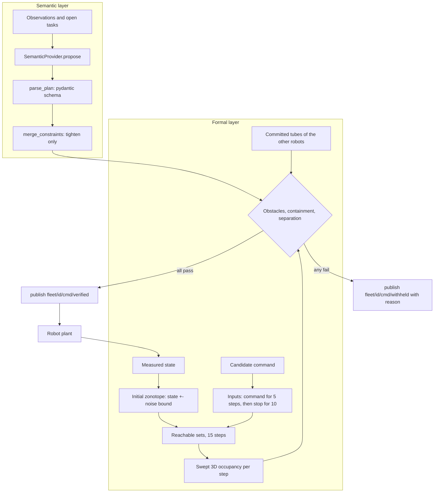

# Architecture

## Components and topics

| Topic | Publisher | Content |
| --- | --- | --- |
| `fleet/<id>/state` | supervisor | measured state |
| `fleet/semantic/scene` | supervisor | scene report sent to the provider |
| `fleet/semantic/plan` | supervisor | validated plan (retained) |
| `fleet/<id>/task/assigned`, `fleet/<id>/task/done` | supervisor | task lifecycle |
| `fleet/<id>/cmd/proposed` | proposer | candidate command and its rank |
| `fleet/<id>/cmd/verified` | safety gate | command the robot may execute |
| `fleet/<id>/cmd/withheld` | safety gate | refused command, violation kind, step, detail |
| `fleet/<id>/cmd/fallback` | supervisor | stop, when nothing verified in this cycle |

A robot subscribes only to its `cmd/verified` and `cmd/fallback` topics. Proposals
never reach it directly.

## Reachability

**Sets.** A zonotope is `{c + G b : |b|_inf <= 1}`. Linear maps and Minkowski sums are
exact and cheap (matrix products and concatenation), which is all a linear system with
additive bounded uncertainty needs.

**Unicycle.** With state `(x, y, th)` and input `(v, w)` the update is
`x+ = x + dt v cos(th)`, `y+ = y + dt v sin(th)`, `th+ = th + dt w`. Around the centre
of the current set the model is linearised with Jacobians `A` and `B`:

`R+ = f(c, u) + A (R - c) + B U_err + W + L`

`U_err` is the actuation error box, `W` the disturbance box and `L` a box that bounds
the second-order Taylor remainder. With heading deviation `d_th` and speed deviation
`d_v` over the current set, the remainder of the x and y updates is at most
`0.5 dt ((|v| + d_v) d_th^2 + 2 d_th d_v)`. The heading update is linear, so its
remainder is zero. Including `L` makes the linearised propagation an over-approximation
of the nonlinear model, not just an approximation.

**Quadrotor.** A point mass with state `(p, v)` and velocity command `v_cmd`, inner
loop `a = k (v_cmd - v) + d` with a bounded acceleration disturbance `d`. The closed
loop is linear, so `R+ = A R + B v_cmd + E D` is exact.

**Occupancy.** Each state set is mapped to the 3D region the body can cover (position
set plus body box). For every step the gate uses a zonotope that contains the convex
hull of the occupancy at step k and at step k + 1.

## What the gate checks

For candidate command `u` the verified input sequence is `u` for one supervisory cycle
(5 steps) followed by the stop command until the horizon (15 steps). For every step:

1. Containment: the interval hull of the occupancy lies inside the workspace, the
   robot's corridor and its altitude band. For box constraints this test is exact.
2. Obstacles and keep-out zones: an interval pre-check, then an exact LP test
   (`Z1` and `Z2` intersect iff `c2 - c1` is in the zonotope with generators `[G1, G2]`).
3. Separation: the occupancy grown by the required distance in every axis must not
   intersect the occupancy of any other robot's tube at the same step. Disjointness of
   the grown set implies an infinity-norm distance, and therefore a Euclidean distance,
   larger than the requirement.

The command's speed is also checked against the robot's speed limit.

## Why a withheld command leaves the team safe

- Every published command comes with a verified tube that ends in a stop.
- In the next cycle each robot is represented, for the others, by the remaining part
  of its last verified tube (`shift_tube`) until it commits to a new one.
- Robots are processed in a fixed order. A robot checks its candidate against the new
  tubes of the robots before it and the remaining tubes of the robots after it. Each
  pair is therefore checked by the later robot against the final choice of the earlier
  one, and by the earlier robot against the fallback of the later one.
- If no candidate verifies, the robot executes the stop it was already cleared for.

Under the modelling assumptions (bounded disturbance and noise, discrete time, a
stopped ground robot does not drift) this gives collision-free operation without
requiring that a new safe command exists in every cycle. The argument is not a formal
proof and the limitations in the README apply.

## Design decisions

**The language model returns text, the supervisor parses it.** `SemanticProvider`
returns a string. Parsing with a strict pydantic schema is a separate step, so a real
model and the mock go through the same validation, and an invalid answer leaves the
previous constraints in place.

**Tighten-only merge.** `merge_constraints` adds keep-out zones, takes the larger
separation, intersects altitude bands and takes the smaller speed limit. It has no
code path that removes an obstacle or widens a corridor. A property test feeds it
random plans to check this.

**Allocation is advisory.** A directive is accepted only for an idle robot that has
the capability the task requires.

**Exact intersection tests instead of interval hulls only.** Interval hulls are cheap
but reject many safe commands near obstacles when the robot moves diagonally. The LP
test is exact for zonotopes and still takes a few milliseconds per verification here.

**Body generators first.** The convex hull enclosure pairs generators column by
column. An early version built the occupancy with the body box last, which misaligned
the columns of consecutive sets and doubled the vertical extent of the enclosure, so
ground robots were refused every command. Placing the body generators first keeps
consecutive sets aligned.

**Deferred keep-out zones.** A zone that appears on top of a robot or across its
committed stop manoeuvre cannot be satisfied by any command. It is deferred and
retried at each semantic update instead of being activated and immediately violated.

**Naive proposers on purpose.** The proposers know the goal and a coarse A* route
hint, but nothing about uncertainty or the other robots. This keeps the division of
labour visible: proposals come from an untrusted source and the gate decides.

## Extending

- Real language model: implement `propose(scene) -> str` or use `OpenAIChatProvider`
  after testing it against your deployment.
- Real transport: replace `MessageBus` by an MQTT client with the same topic layout.
- Other robots: add a model with `reach`, `occupancy`, `measurement_set`,
  `stop_command` and `simulate_step`.
