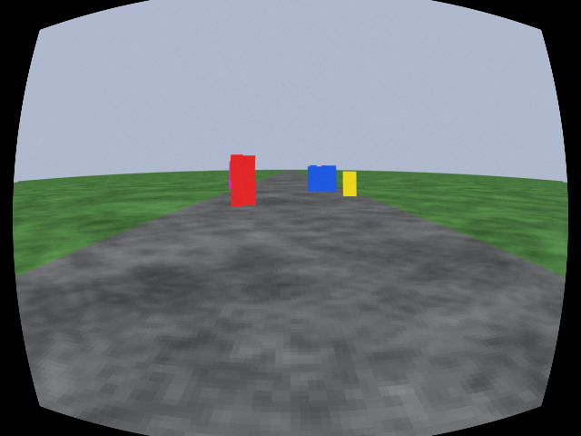
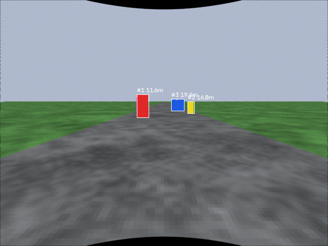
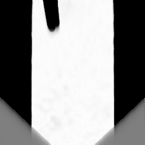
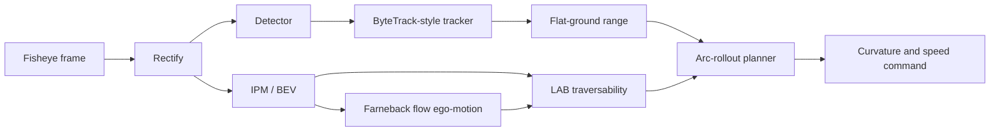

# vision-only-autonomy-pipeline

A causal, CPU-only perception and decision pipeline that turns a single monocular
fisheye stream into tracked objects with metric range, an ego-motion estimate, a
traversability map and a steering and speed command.

Reference implementation by the author of the "Vision-Only Autonomy Analysis Pipeline"
developed at the TUM Multi-Robot Systems Lab (TUM Heilbronn). It is a clean, tested
re-implementation of the concepts for readers and reviewers. It is not the original
research code, it contains no lab data, and every number below comes from synthetic
scenes rendered by this repository.

## Background

The original pipeline analyses what a robot can decide from one forward fisheye camera
and nothing else: no lidar, no depth sensor, no wheel odometry. The design constraints
carried over into this repository are:

- causal processing: each stage uses only the current and past frames;
- real-time capable on a CPU, with the latency of every stage measured;
- geometry first: range comes from the calibrated camera and the flat-ground
  assumption, not from a learned depth network;
- a detector behind an interface, so the tracker and everything after it do not
  depend on a specific model.

## Features

| Stage | What is implemented | Module |
| --- | --- | --- |
| Camera models | Pinhole with Brown distortion, equidistant fisheye (same parameters as `cv2.fisheye`), projection, unprojection, remap-based rectification, calibration helper | `camera.py` |
| Flat-ground geometry | Pixel to ground back-projection for range, inverse perspective mapping (IPM) homography, bird's-eye-view grid | `geometry.py` |
| Detection | `Detector` protocol, classical HSV colour-blob detector for the synthetic scenes, optional YOLO adapter (not exercised here) | `detection.py` |
| Tracking | ByteTrack-style tracker: box Kalman filter, IoU association in a high and a low confidence stage, Hungarian assignment (scipy), track lifecycle, buffered IoU for lost tracks, short coasting, EMA smoothing, offline gap interpolation | `kalman.py`, `tracker.py` |
| Ego-motion | Farneback dense optical flow on a near-field IPM image, robust rigid 2D fit, speed and yaw rate | `egomotion.py` |
| Traversability | LAB distance to a self-supervised ground model, motion-compensated temporal filter | `traversability.py` |
| Local planning | DWA-style rollout of nine constant-curvature arcs, hysteresis, slew-rate limit, speed from free length | `planner.py` |
| Evaluation | MOTA, MOTP, ID switches, IDF1 | `metrics.py` |
| Synthetic data | Road scene renderer with moving objects and exact ground truth (boxes, range, visibility, ego pose) | `synthetic.py` |

## Quickstart

```bash
python -m venv .venv && source .venv/bin/activate
pip install -e ".[dev]"
make test      # pytest
make lint      # ruff
make demo      # python examples/run_demo.py
```

Minimal use of the pipeline on your own frames:

```python
from vision_autonomy import VisionPipeline
from vision_autonomy.benchmark import make_cameras

raw_camera, rectified_camera = make_cameras()   # replace with your calibration
pipeline = VisionPipeline(raw_camera, rectified_camera)
result = pipeline.step(frame_bgr, dt=0.1)
for t in result.tracks:
    print(t.track.track_id, t.track.label, f"{t.range_m:.1f} m")
print(result.ego, result.plan.curvature, result.plan.speed)
```

## Demo output

Output of `python examples/run_demo.py`, pasted from a run in the development
container (Python 3.13, OpenCV 5.0.0, 2 CPU threads, x86_64). The stream is a
synthetic 640x480 fisheye sequence at 10 Hz with eight moving objects that occlude
each other. Reproduce it with `make demo`.

```text
Vision-only autonomy pipeline: synthetic benchmark
python 3.13.17, opencv 5.0.0, numpy 2.5.3, 2 CPU threads, x86_64
stream: 640x480 synthetic fisheye, 10 Hz, 150 frames, 8 moving objects

1) Tracking (IoU 0.5, objects over 150 px2 and at least half visible)
  all detections, online             MOTA  0.945  IDF1  0.790  IDSW  2  recall 0.958  precision 0.990
  20% dropped, online, no coasting   MOTA  0.770  IDF1  0.705  IDSW  2  recall 0.773  precision 1.000
  20% dropped, online, coast 2       MOTA  0.933  IDF1  0.788  IDSW  2  recall 0.945  precision 0.992
  20% dropped, offline gap interp.   MOTA  0.935  IDF1  0.790  IDSW  2  recall 0.941  precision 0.998

2) Flat-ground range from the box foot point (matched tracks)
   0-10 m: n= 117  mean abs error  0.07 m  mean rel error  1.1 %
  10-20 m: n= 285  mean abs error  0.27 m  mean rel error  1.9 %
  20-30 m: n= 101  mean abs error  0.72 m  mean rel error  3.0 %
  all     : n= 503  mean abs error  0.32 m  mean rel error  1.9 %

3) Ego-motion from Farneback flow on the near-field IPM (true speed 2.0 m/s)
  speed error    mean 0.036 m/s, p95 0.051 m/s
  yaw-rate error mean 0.0059 rad/s, p95 0.0145 rad/s
  valid estimates: 100 % of frames

4) Per-stage latency on this CPU (single process, first 5 frames skipped)
  rectify         mean   2.13 ms   p95   2.53 ms
  detect          mean   2.08 ms   p95   3.03 ms
  track           mean   0.47 ms   p95   0.64 ms
  range           mean   0.11 ms   p95   0.14 ms
  bev             mean   0.46 ms   p95   0.52 ms
  egomotion       mean   3.21 ms   p95   4.08 ms
  traversability  mean   2.81 ms   p95   3.76 ms
  plan            mean   0.54 ms   p95   0.79 ms
  total           mean  11.81 ms   p95  14.88 ms
  throughput: 84.7 frames per second

5) Closed loop: planner drives a sinusoidal road with 3 parked objects
  distance travelled 38.7 m in 20 s
  on-road ratio 100 %, max offset from centre line 1.78 m (road half width 3.50 m)
  minimum clearance to an object 1.24 m, stops 0, candidate switches 10
  largest curvature step 0.050 1/m per cycle (limit 0.050)
```

How to read these numbers:

- They describe this code on clean synthetic scenes with a colour detector that is
  nearly perfect on those scenes. They say nothing about real-world accuracy.
- The two identity switches happen when an object reappears after being fully hidden
  behind another one for about a second. Motion-only association does not recover
  those cases; an appearance model would be the next step.
- Latency is wall-clock time in one Python process and varies between runs on a shared
  machine. Other runs in the same container gave a total between about 12 and 24 ms
  per frame. The detector stage would dominate with a neural detector.
- Range error grows with distance because one pixel covers more ground far away (see
  `test_one_pixel_error_grows_quadratically_with_range`).

A raw synthetic fisheye frame, the rectified frame with track ids and ranges, and the
traversability grid (white is drivable):

| Raw fisheye input | Rectified with tracks | Traversability (BEV) |
| --- | --- | --- |
|  |  |  |

## Architecture



Details, coordinate frames and design decisions are in
[docs/architecture.md](docs/architecture.md).

## Tests

`pytest -q` runs 49 tests in about 20 seconds: camera models against OpenCV, rectification,
calibration on synthetic target views, ground projection round trips, IPM consistency,
detector, Kalman filter, tracker behaviour (two-stage association, occlusion recovery,
class-aware matching, lifecycle), metrics on hand-computed cases, ego-motion,
traversability, planner (hysteresis, slew limit, stop) and two end-to-end benchmarks.
CI (`.github/workflows/ci.yml`) runs ruff and pytest.

## Limitations

- Synthetic data only. The renderer draws flat coloured billboards on a textured
  plane; there is no lighting change, motion blur, rolling shutter or real clutter.
- The flat-ground assumption is used for range, IPM and ego-motion. Slopes, bumps and
  camera pitch changes (braking, acceleration) are not modelled and would bias all three.
- The built-in detector only finds saturated colour blobs. A real system needs a
  learned detector behind the same interface. `YoloAdapter` is provided as an optional
  thin adapter but was not run or tested in this repository.
- The tracker has no appearance features, so identities are lost after long full
  occlusions (visible in the IDF1 value above).
- Ego-motion from ground flow needs visible, textured ground close to the vehicle and
  slightly underestimates speed (about 2 percent in the demo).
- Traversability is a colour similarity test against the patch in front of the
  vehicle. It fails when drivable and non-drivable surfaces have the same colour.
- The planner is a local reactive planner without a vehicle dynamics model, moving
  object prediction or a global route. The closed-loop demo uses parked objects only.
- Camera intrinsics, height and pitch are assumed to be known. Online extrinsic
  calibration is out of scope.

## License

MIT, see [LICENSE](LICENSE). Copyright (c) 2026 M. Emad Dwedar.
