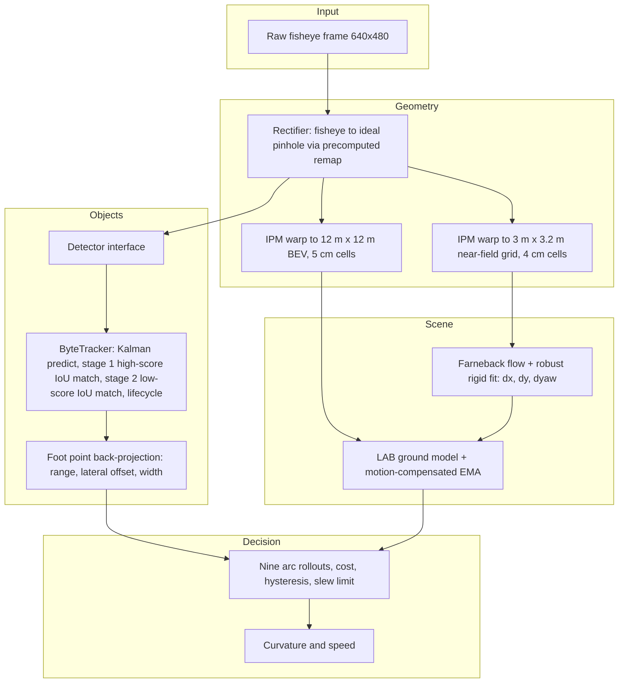

# Architecture

## Data flow

`VisionPipeline.step` runs these stages in order and records the wall-clock time of
each one. No stage looks at future frames. The only non-causal function in the package
is `interpolate_gaps`, which is an offline analysis tool and is reported separately.

## Coordinate frames

- Camera frame: x right, y down, z along the optical axis.
- Vehicle frame: x forward, y left, z up, origin on the ground below the camera.
- Image: (u, v) with pixel centres at integer coordinates.
- BEV grid: row 0 is the far edge, column 0 is the left edge, so the grid reads like a
  map with the vehicle at the bottom centre.

The camera is mounted at a known height and pitched down by a known angle.
`camera_rotation(pitch)` is the single place where the camera to vehicle rotation is
defined.

## Design decisions

**Own camera models instead of only calling OpenCV.** Projection and unprojection are
written in numpy for both models and are tested against `cv2.projectPoints` and
`cv2.fisheye.projectPoints`. Having `project` and `unproject` on both models makes
`build_remap(src, dst)` generic: the same function rectifies a fisheye stream and
synthesises a fisheye view from a pinhole render.

**Range from geometry.** The range of an object is the intersection of the ray through
the bottom centre of its box with the ground plane. This needs no training data and its
error model is explicit: the error is dominated by the foot point row and grows roughly
with the square of the distance.

**ByteTrack-style association.** Low-score detections are usually real objects that are
far away or partly hidden. They are only allowed to continue existing tracks, never to
start new ones. Three additions to the published algorithm are documented in the code:
association never mixes classes, lost tracks are matched with a buffered IoU that grows
with the time since the last update, and the velocity process noise is larger than the
ByteTrack default because the target stream is 10 Hz from a moving camera.

**Flow on the IPM image, near field only.** On a bird's-eye view a static flat ground
moves as a rigid 2D transform, which reduces dense flow to three numbers with a robust
Kabsch fit. During development the first version used the full 12 m grid and
underestimated speed by almost half. The cause is physical: beyond a few metres one
image pixel covers many BEV cells, so the far part of the IPM image is an interpolation
of very few samples and does not move coherently. The flow grid therefore covers only
1.4 m to 4.4 m ahead, where the camera samples the ground densely.

**Self-supervised ground model in LAB.** The patch in front of the vehicle defines what
drivable ground looks like. Lightness is down-weighted so shadows matter less than
chroma. The previous estimate is warped by the ego-motion before blending, otherwise
the temporal filter would smear the map while driving.

**Hysteresis and slew limit in the planner.** With a small discrete candidate set, two
arcs often have nearly the same cost and noise makes the minimum alternate between
them. The planner keeps its previous choice unless another arc is better by a margin,
and the published curvature can change by a bounded amount per cycle.

**Evaluation protocol.** Ground truth objects smaller than 150 square pixels, less than
half visible or mostly outside the image are not required to be tracked. Hypotheses on
such objects are ignored instead of counted as false positives, following the ignore
region convention of public tracking benchmarks. The thresholds are parameters of
`evaluable_truth`.

## Extending

- Real detector: implement `Detector.detect(image) -> list[Detection]`. `YoloAdapter`
  shows the mapping for Ultralytics models.
- Real camera: build a `FisheyeCamera` or `PinholeCamera` from your calibration and
  pass the mounting height and pitch in `PipelineConfig`.
- Different vehicle: adjust `PlannerConfig` (width, curvature range, speeds).
