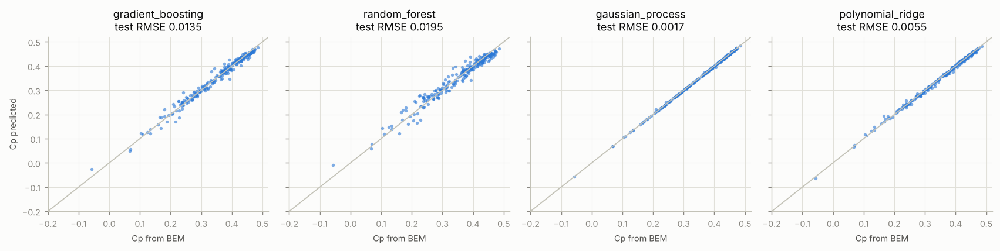
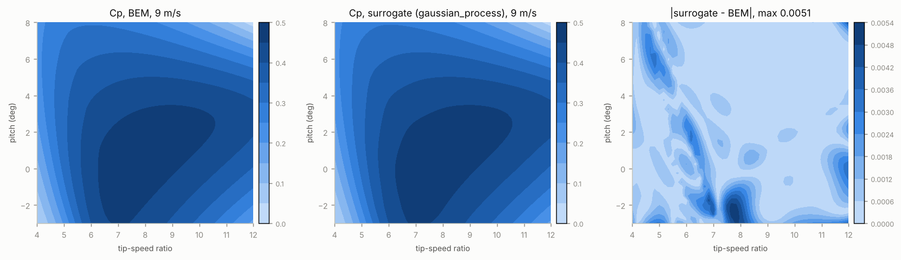
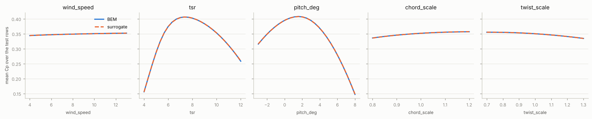
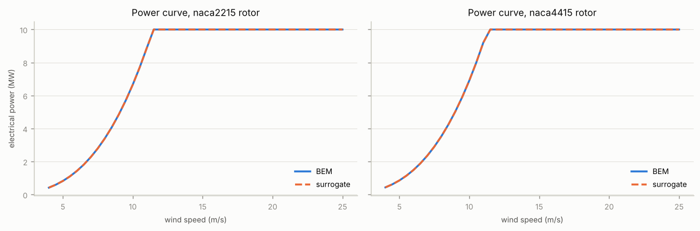

# wind-turbine-surrogate-ml

A physics-based data generator (steady Blade Element Momentum solver in numpy) and
a complete machine-learning surrogate workflow for the power coefficient of a
generic 10 MW-class wind turbine rotor.

## What it is

A reference implementation by the author of the work listed under Background. It
shows the data-science workflow used when an expensive aerodynamic simulation is
replaced by a surrogate model:

1. design of experiments (Latin hypercube),
2. simulation runs to label the design,
3. feature engineering,
4. surrogate models with cross-validation and hyperparameter search,
5. uncertainty estimates and their calibration check,
6. interpretation (permutation importance, partial dependence),
7. surrogate-based optimisation, verified against the simulator,
8. a downstream engineering quantity: power curve and annual energy production.

What it is **not**: it is not the CFD data, the CFD setup or the code of the
research project, and it does not reproduce results of the paper. The CFD data is
not available here, so a BEM solver written for this repository plays the role of
the simulator. The rotor geometry is **illustrative** (Schmitz optimum chord and
twist with a chord cap, one airfoil family along the span), and the airfoil polars
are **analytical approximations** (thin-airfoil lift, logistic stall blend to a flat
plate, parabolic drag). The labels "naca4415" and "naca2215" name the camber lines
used for the zero-lift angle; the polars are not measured or computed polars of
these airfoils.

## Background

- The author's work at TH Koeln coupled CFD simulations with machine-learning
  surrogate models for 10 MW wind turbines.
- M. Dwedar, F. Koese, F. Bayram, A. Jesser (2024), "Investigation of the Generated
  Energy, Noise and Performance on High Capacity 10 MW Wind Turbines with Two
  Different NACA 4415-2215 Airfoil Profiles", 2024 4th International Conference on
  Smart Grid and Renewable Energy (SGRE), IEEE.

## Features

- `bem.py`: steady BEM solver vectorised over operating points. Residual formulation
  in the inflow angle (Ning, 2014) solved by bracketing and bisection, Prandtl tip
  and root loss, Buhl correction for high induction.
- `airfoils.py`, `rotor.py`: approximate polars for two airfoil families and an
  illustrative 89 m radius, three-bladed rotor.
- `doe.py`: maximin Latin hypercube over wind speed, tip-speed ratio, pitch, chord
  scale and twist scale, plus the airfoil family as a balanced categorical factor.
- `dataset.py`: dataset generation, CSV export, physics-informed features
  (estimated angle of attack at 75 percent span, loading parameter, Reynolds number).
- `models.py`: gradient boosting, random forest, Gaussian process and polynomial
  ridge with randomised hyperparameter search and 5-fold cross-validation.
- `uncertainty.py`: GP posterior, tree spread, quantile boosting, constant-sigma
  intervals, and split conformal intervals; coverage and width measured on test data.
- `interpret.py`: permutation importance and partial dependence on the raw design
  variables.
- `optimise.py`: Cp maximisation with the same optimiser on the BEM model and on
  each surrogate, with measured wall times and throughput.
- `power.py`: power curve with a tip-speed limit and rated-power cap, Weibull
  distribution, AEP and capacity factor.
- `report.py`, `plots.py`: results report, model card and figures in `docs/`.

## Quickstart

```bash
pip install -e ".[dev]"
make test        # python -m pytest
make demo        # python examples/demo.py, about 1 minute
make pipeline    # python -m wtsurrogate.cli pipeline --out docs, about 7 minutes on 2 CPU cores
```

```python
import numpy as np
from wtsurrogate import reference_rotor, solve_bem

rotor = reference_rotor("naca4415")
result = solve_bem(rotor, wind_speed=9.0, tsr=np.array([6.0, 7.5, 9.0]), pitch=0.0)
print(result.cp, result.ct)
```

## Demo output

Pasted from `python examples/demo.py` in the build container (Python 3.13, 2 CPU
cores). The demo uses a reduced budget (400 BEM samples, two model families).
Timings vary by machine.

```text
BEM check, illustrative 10 MW-class rotor (naca4415 approximation), 9 m/s, pitch 0
  TSR  5.0  Cp 0.3148  Ct 0.4629
  TSR  6.0  Cp 0.4319  Ct 0.6478
  TSR  7.0  Cp 0.4775  Ct 0.7692
  TSR  8.0  Cp 0.4783  Ct 0.8499
  TSR  9.0  Cp 0.4567  Ct 0.9163
  TSR 10.0  Cp 0.4269  Ct 0.9798

pipeline on a reduced budget (400 BEM samples, 2 model families)
dataset: 400 of 400 BEM runs kept (0 failed), 0.23 s
gaussian_process   cv rmse 0.00335 +/- 0.00122  test rmse 0.00238  r2 0.9992  search 8.5 s
polynomial_ridge   cv rmse 0.02431 +/- 0.00431  test rmse 0.02354  r2 0.9195  search 0.1 s
selected by CV RMSE: gaussian_process
uncertainty, importance and partial dependence done
optimisation study done in 24.7 s
power curve and AEP done

summary
  gaussian_process   CV RMSE 0.00335  test RMSE 0.00238  test R2 0.9992
  polynomial_ridge   CV RMSE 0.02431  test RMSE 0.02354  test R2 0.9195
  selected model: gaussian_process, 90 percent interval coverage 0.850 (native), 0.850 (conformal)
  optimum naca4415: direct BEM Cp 0.4850 in 13.3 s, surrogate optimum verified by BEM Cp 0.4843 in 0.2 s (66.0x)
  optimum naca2215: direct BEM Cp 0.4711 in 10.5 s, surrogate optimum verified by BEM Cp 0.4710 in 0.2 s (46.3x)
  AEP naca4415 at 8.5 m/s mean wind: BEM 40.34 GWh, surrogate 40.39 GWh (+0.134 percent)
  AEP naca2215 at 8.5 m/s mean wind: BEM 39.68 GWh, surrogate 39.61 GWh (-0.172 percent)
```

## Results of the full pipeline

All numbers below are copied from [docs/results.md](docs/results.md), which is
written by `python -m wtsurrogate.cli pipeline` (seed 0, 1500 BEM runs, none failed
to converge; 1050 train, 225 calibration and 225 test rows). Raw values are in
[docs/results.json](docs/results.json), the dataset in
[docs/bem_dataset.csv](docs/bem_dataset.csv) and the model card in
[docs/model_card.md](docs/model_card.md).

### Surrogate accuracy for Cp

| model | train rows | CV RMSE (5-fold) | test RMSE | test max error | test R2 | search time (s) |
|---|---|---|---|---|---|---|
| gradient_boosting | 1050 | 0.01430 +/- 0.00124 | 0.01349 | 0.0486 | 0.9801 | 38.9 |
| random_forest | 1050 | 0.02215 +/- 0.00231 | 0.01954 | 0.0602 | 0.9582 | 20.5 |
| gaussian_process (selected) | 500 | 0.00175 +/- 0.00025 | 0.00168 | 0.0113 | 0.9997 | 27.9 |
| polynomial_ridge | 1050 | 0.00591 +/- 0.00081 | 0.00550 | 0.0291 | 0.9967 | 0.9 |

The response surface is smooth, so the Gaussian process and the polynomial model
are far more accurate than the tree ensembles, even though the Gaussian process
sees fewer than half of the training rows. Tree ensembles are the wrong tool for
this problem: their piecewise-constant fit needs many more samples.





### Uncertainty (nominal 90 percent intervals, measured on the test split)

| model | native interval | native coverage | native mean width | conformal coverage | conformal mean width |
|---|---|---|---|---|---|
| gradient_boosting | quantile regression | 0.662 | 0.0945 | 0.889 | 0.0373 |
| random_forest | spread of individual trees | 0.969 | 0.0960 | 0.867 | 0.0565 |
| gaussian_process | GP posterior standard deviation | 0.898 | 0.0047 | 0.933 | 0.0049 |
| polynomial_ridge | constant sigma equal to CV RMSE | 0.916 | 0.0194 | 0.898 | 0.0178 |

The Gaussian process intervals are close to nominal at 90 percent but too wide at
50 percent (measured coverage 0.649) and slightly too narrow at 95 percent (0.929).
Quantile gradient boosting under-covers clearly (0.662 instead of 0.90) on this
small dataset. With 225 test rows the sampling error of a coverage estimate is
about 0.02.

### Interpretation

| design variable | drop in test R2 when shuffled |
|---|---|
| pitch_deg | 1.3599 +/- 0.0975 |
| tsr | 1.3051 +/- 0.1081 |
| airfoil_index | 0.1721 +/- 0.0154 |
| chord_scale | 0.1008 +/- 0.0093 |
| twist_scale | 0.0527 +/- 0.0074 |
| wind_speed | 0.0017 +/- 0.0002 |

Wind speed has almost no influence on Cp. That is expected and is a property of
the generator: Cp is dimensionless, and wind speed enters only through the weak
Reynolds number dependence of the approximate drag model.



### Surrogate-based optimisation (9 m/s, maximise Cp over TSR, pitch, chord scale, twist scale)

| airfoil | objective model | Cp predicted | Cp by BEM at that point | Cp gap to direct optimum | evaluations | optimiser time (s) | speed-up | speed-up incl. data and tuning |
|---|---|---|---|---|---|---|---|---|
| naca4415 | direct BEM | 0.4851 | 0.4851 | 0.0000 | 2624 | 50.6 | 1.0x | 1.0x |
| naca4415 | gradient_boosting | 0.4785 | 0.4822 | 0.0029 | 2624 | 15.1 | 3.4x | 0.93x |
| naca4415 | random_forest | 0.4769 | 0.4824 | 0.0027 | 2624 | 41.5 | 1.2x | 0.81x |
| naca4415 | gaussian_process | 0.4834 | 0.4836 | 0.0015 | 2624 | 1.0 | 50.9x | 1.73x |
| naca4415 | polynomial_ridge | 0.4835 | 0.4844 | 0.0007 | 1984 | 1.1 | 46.3x | 21.58x |
| naca2215 | direct BEM | 0.4720 | 0.4720 | 0.0000 | 2624 | 49.6 | 1.0x | 1.0x |
| naca2215 | gaussian_process | 0.4695 | 0.4712 | 0.0008 | 2624 | 0.8 | 58.4x | 1.71x |

How to read this honestly:

- Every surrogate optimum, re-evaluated with BEM, is within 0.003 Cp of the direct
  optimum, and none exceeds it. The design variables at the optimum differ between
  runs (see docs/results.md) because the optimum is flat; the direct optimum sits on
  the lower twist-scale bound.
- The selected Gaussian process makes the optimiser loop 51x and 58x faster than
  the BEM loop. Once the time for generating the data and tuning the model is
  charged, the gain for a single optimisation is 1.7x. Gradient boosting and the
  random forest are then slower than calling BEM directly (0.93x and 0.81x).
- The polynomial model, not the selected model, gave the smallest gap for naca4415
  (0.0007 vs 0.0015). Selection by CV RMSE does not guarantee the best optimum.
- BEM is a cheap simulator: one vectorised call labels 1500 operating points in
  0.35 s. The measured speed-ups say nothing about CFD, where a single evaluation
  takes hours and the balance is very different. No such claim is made here.

Measured throughput (rows per second): BEM 60 single-row and 2778 batched, Gaussian
process 3709 and 147959, polynomial ridge 2144 and 121036, gradient boosting 199 and
24276, random forest 67 and 8532.

### Power curve and AEP (baseline geometry, Weibull shape 2)

Rated power 10 MW, drivetrain efficiency 0.94, tip-speed limit 90 m/s, cut-in
4 m/s, cut-out 25 m/s. These limits are assumptions of this example.

| airfoil | mean wind speed (m/s) | AEP from BEM (GWh) | AEP from surrogate (GWh) | relative error (%) | capacity factor (BEM) |
|---|---|---|---|---|---|
| naca4415 | 7.5 | 33.23 | 33.24 | +0.007 | 0.379 |
| naca4415 | 8.5 | 40.34 | 40.34 | +0.005 | 0.460 |
| naca4415 | 10 | 48.80 | 48.80 | +0.003 | 0.557 |
| naca2215 | 7.5 | 32.58 | 32.58 | +0.008 | 0.372 |
| naca2215 | 8.5 | 39.68 | 39.68 | +0.007 | 0.453 |
| naca2215 | 10 | 48.19 | 48.19 | +0.005 | 0.550 |

Both models reach rated power at 11.5 m/s on the 0.5 m/s grid, and the largest
difference between the two power curves below 13 m/s is 1.0 kW. Above 13 m/s both
curves assume rated power; the BEM model confirms that a pitch angle holding rated
power exists (10.7, 16.9 and 22.1 degrees at 15, 20 and 25 m/s for naca4415). The
AEP values contain no wake, availability or electrical losses beyond the drivetrain
efficiency, so they are gross values of this simplified model.



## Architecture

See [docs/architecture.md](docs/architecture.md) for the mermaid diagram, the module
table and the design decisions. Other figures in `docs/`: `polars.png`,
`rotor_geometry.png`, `bem_spanwise.png`, `permutation_importance.png`,
`uncertainty_intervals.png`.

```text
src/wtsurrogate/
  airfoils.py  rotor.py  bem.py          physics
  doe.py       dataset.py                design of experiments, data, features
  models.py    uncertainty.py  interpret.py
  optimise.py  power.py
  pipeline.py  report.py  plots.py  cli.py
```

## Tests

```bash
python -m pytest
```

44 tests, about one minute. Examples of what they check: the thin-airfoil zero-lift
angle of a 4 percent camber line (-4.15 degrees), element-wise agreement of blade
element thrust and momentum thrust in the BEM solution (relative tolerance 1e-4),
Cp below the Betz limit with a peak near the design tip-speed ratio, batch results
equal to single calls, the stratification property of the Latin hypercube, the
Weibull mean, the AEP of a constant power curve against the closed form, conformal
coverage on heavy-tailed residuals, and an end-to-end pipeline run. CI
(`.github/workflows/ci.yml`) runs ruff and pytest on Python 3.10 and 3.12. The
workflow file has not been executed on GitHub; lint and tests were run locally on
Python 3.13.

## Limitations

- The simulator is a steady BEM model with uniform inflow. No yaw, shear, tower
  shadow, dynamic stall, 3-D rotational augmentation or aeroelastic effects.
- The polars are approximations with assumed stall angles and minimum drag values.
  The maximum lift of the "naca4415" approximation is about 1.27, lower than
  published values for the real airfoil. Differences between the two families
  reflect the approximations, not a validated airfoil comparison.
- The rotor is illustrative. The BEM model was verified for internal consistency
  (momentum balance, limits) but not validated against a reference turbine, CFD or
  measurements.
- The surrogate reproduces the generator inside the sampled bounds only. The test
  split is drawn from the same Latin hypercube, so reported errors are interpolation
  errors.
- The Gaussian process is trained on a 500-row subsample; the learning curve in
  docs/results.md is not monotone in detail (0.00320 at 400 rows, 0.00172 at 500),
  which reflects sensitivity to the kernel hyperparameter fit.
- Results come from one seed. Timings were measured once on a 2-core container.
- The power curve uses a grid search over tip-speed ratio and pitch as a stand-in
  for a controller, and assumes ideal pitch regulation above 13 m/s.
- The source is about 2200 lines, somewhat more than a minimal example needs,
  because the physics generator and the workflow are both included.

## License

MIT, Copyright (c) 2026 M. Emad Dwedar. See [LICENSE](LICENSE).
