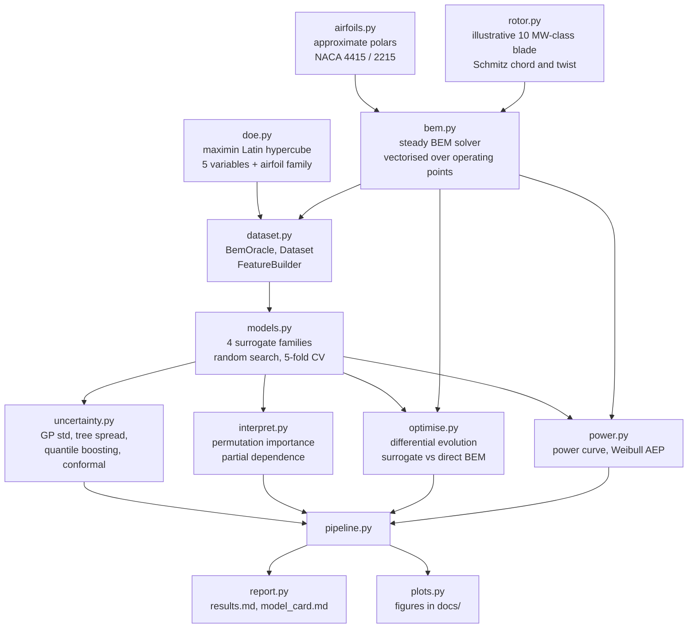

# Architecture

## Data flow

## Modules

| module | responsibility |
|---|---|
| `airfoils.py` | Thin-airfoil lift with numerically integrated zero-lift angle, logistic stall blend to a flat-plate model, parabolic drag bucket with weak Reynolds dependence |
| `rotor.py` | Blade discretisation; Schmitz optimum chord and twist, capped chord; chord and twist scaling |
| `bem.py` | Residual formulation in the inflow angle (Ning, 2014), bracketing and bisection, Prandtl tip and root loss, Buhl correction |
| `doe.py` | Latin hypercube sampling with a maximin selection among candidates, design space bounds |
| `dataset.py` | `BemOracle` (design-matrix rows to Cp and Ct), dataset container with CSV export, physics-informed features |
| `models.py` | Model specifications and search spaces, `tune_and_evaluate`, `Surrogate` wrapper with the same call signature as the BEM oracle |
| `uncertainty.py` | Native interval estimators per model family, split conformal half-width, coverage and width metrics |
| `interpret.py` | Permutation importance and partial dependence on raw design variables |
| `optimise.py` | Cp maximisation with identical optimiser settings for BEM and surrogates, throughput measurement |
| `power.py` | Weibull distribution, control-grid power curve, AEP, capacity factor, BEM pitch needed for rated power |
| `pipeline.py` | Orchestration, returns one JSON-serialisable results dictionary |
| `report.py`, `plots.py`, `cli.py` | Markdown reports, figures, command line |

## Design decisions

1. **BEM as the data generator.** The author's research coupled CFD with surrogate
   models. CFD data cannot be shipped or regenerated in a test suite, so a steady BEM
   model stands in as the expensive simulator. The workflow (design of experiments,
   surrogate, validation against the simulator, optimisation) is the same; the
   absolute numbers are not comparable with CFD.

2. **Residual formulation instead of fixed-point iteration.** The classical BEM
   iteration on the induction factors can oscillate or diverge for heavily loaded
   elements. Solving one scalar residual in the inflow angle with bisection has a
   guaranteed bracket in the normal operating region, and it vectorises over
   thousands of operating points with plain numpy. In the documented run every
   sampled operating point converged.

3. **One vectorised call per airfoil family.** `BemOracle.evaluate` groups rows by
   airfoil family. Generating the whole dataset takes less than a second, which also
   means the batched BEM model is a strong baseline for the speed comparison. The
   speed-up tables report single-row calls and batched calls separately, and the
   optimisation table includes a column that charges the surrogate for data
   generation and hyperparameter search.

4. **Features are functions of inputs only.** `FeatureBuilder` adds the estimated
   angle of attack at 75 percent span, a loading parameter and a Reynolds number.
   They use the known reference geometry, never a BEM output, so there is no leakage.

5. **Interpretation on raw variables.** Because the engineered features are
   deterministic functions of the design variables, importance and partial
   dependence perturb the raw variable and rebuild the features. Perturbing an
   engineered column alone would create inputs that cannot occur.

6. **Model selection by cross-validation, test split touched once.** The split is
   70 percent train, 15 percent calibration (only used for conformal intervals) and
   15 percent test. The model used for optimisation and AEP is chosen by CV RMSE.

7. **Gaussian process on a subsample.** Exact GP training is cubic in the number of
   rows, so it is fitted on at most 500 training rows. The results table states the
   number of rows used by every model.

8. **Same optimiser for all objectives.** Differential evolution with identical
   population, generations and tolerance is used on the BEM model and on every
   surrogate. Each surrogate optimum is re-evaluated with the BEM model, and the gap
   to the direct optimum is reported.

9. **Power curve assumption above the sampled wind speeds.** The design space ends
   at 13 m/s. Above that the power curve assumes rated power. The BEM model is used
   to check that a pitch angle holding rated power exists at 15, 20 and 25 m/s.
